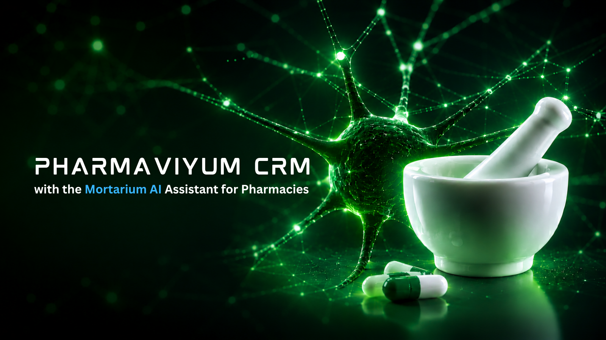

<p align="center">
  
</p>

# Pharmaviyum CRM

    

> AI-powered CRM platform for pharmacies, designed to complement existing ERP systems with client-oriented workflows, order handling, analytics, and AI-assisted knowledge retrieval.

## Overview

Pharmaviyum CRM is a modular pharmacy CRM platform built around a FastAPI backend, a React frontend, PostgreSQL with pgvector, Redis, and an AI/RAG layer.

The system is designed to centralize pharmacy workflows and client interactions without replacing the pharmacy's core ERP. The AI layer provides application-level orchestration, retrieval-augmented generation (RAG), dialogue memory, guardrails, tool access, and observability.

The repository is currently developed and reviewed through the `dev` branch.

## Demo / NDA Notice

This repository is intended for technical evaluation and architectural review.

- Demo data is synthetic.
- No real client data is included.
- Proprietary production integrations and business logic are not exposed here.
- Access and redistribution are subject to the applicable NDA and author permission.

### Legal Notice

This project and its contents are protected by applicable confidentiality and NDA obligations. The repository must not be copied, redistributed, or used outside the permitted evaluation scope without explicit written permission from the author.

## Architecture

```text
                         +----------------------+
                         |   React Frontend     |
                         |  TypeScript / Vite   |
                         +----------+-----------+
                                    |
                                    v
                         +----------------------+
                         |     FastAPI API      |
                         |  Auth / Tenant / API |
                         +----------+-----------+
                                    |
             +----------------------+----------------------+
             |                      |                      |
             v                      v                      v
      +-------------+        +-------------+        +-------------+
      | PostgreSQL  |        |    Redis    |        |  AI / RAG   |
      | + pgvector  |        | cache/state |        | Agent/MCP    |
      +-------------+        +-------------+        +------+------+ 
                                                             |
                                                     +-------+-------+
                                                     | Ollama / LLM |
                                                     +---------------+

                         Background ingestion
                                  |
                                  v
                           Celery worker
```

The main backend lives under `src/pharmaviyum`. The AI/RAG functionality is integrated into the backend, while `mortarium-ai` is retained as a separate service in the deployment stack.

## Core Capabilities

- Pharmacy CRM workflows and client-oriented operations
- User, patient, product, order, and audit-oriented domain functionality
- Authentication and tenant/pharmacy context
- FastAPI REST API with OpenAPI documentation
- AI-assisted queries and streaming responses
- Retrieval-augmented generation over application documents
- Tenant-safe document retrieval and source citations
- Dialogue memory, guardrails, caching, and model routing
- MCP tool/resource integration
- Background document ingestion through Celery
- Application metrics and optional distributed tracing

## Technology Stack

### Backend

- Python 3.13+
- FastAPI 0.141.1
- Uvicorn
- Pydantic / Pydantic Settings
- SQLAlchemy 2
- Alembic
- asyncpg / psycopg

### Data & Infrastructure

- PostgreSQL 16
- pgvector
- Redis 7
- Docker / Docker Compose
- Nginx

### AI / RAG

- LangGraph
- LangChain
- LangChain Ollama integration
- Ollama / configured LLM provider
- PostgreSQL + pgvector for vector retrieval
- MCP JSON-RPC tool layer

### Frontend

- React 18
- TypeScript
- Vite
- TanStack Query
- TanStack Router
- Axios
- Vitest
- Playwright

The backend dependency versions are defined in `pyproject.toml`; the frontend scripts and dependencies are defined in `frontend/package.json`.

## AI / RAG

The AI layer is implemented under `src/pharmaviyum/ai` and exposed through the FastAPI application.

The current RAG pipeline follows this flow:

```text
Query
  -> transform_query
  -> retrieve
  -> grade_documents
  -> compress
  -> generate
  -> guardrails
```

Key design properties include:

- retrieval scoped to the authenticated pharmacy/tenant context;
- country and language carried through query context;
- retrieved documents treated as untrusted input before generation;
- stable source identifiers for citations;
- explicit checkpoint/thread scope derived from authenticated context;
- low-cardinality observability labels.

The repository's detailed AI architecture is documented in [`docs/ai_architecture.md`](docs/ai_architecture.md).

## Project Structure

```text
.
├── src/pharmaviyum/       # Main FastAPI backend
│   ├── api/               # API routes
│   ├── ai/                # AI, RAG and MCP
│   ├── core/              # Core application infrastructure
│   ├── domain/            # Domain models and business concepts
│   └── ...
├── frontend/              # Frontend application
├── mortarium-ai/          # Separate AI service used by deployment stack
├── alembic/               # Database migrations
├── docker/                # Monitoring and Docker-related configuration
├── nginx/                 # Reverse proxy configuration
├── scripts/               # Development and operational scripts
├── docs/                  # Architecture, ADRs and development guides
├── tests/                 # Automated tests
├── docker-compose.yml     # Main local Docker Compose stack
├── pyproject.toml         # Python project and tooling configuration
└── README.md              # Project overview
```

## Development

### Prerequisites

- Python 3.13+
- Docker and Docker Compose
- Bun for frontend development

### Backend

Install the Python dependencies and apply migrations:

```bash
pip install -r requirements.txt
alembic upgrade head
```

Run the API locally:

```bash
uvicorn src.pharmaviyum.main:app --reload --port 8000
```

Local API documentation is available at:

- Swagger UI: `http://localhost:8000/docs`
- OpenAPI JSON: `http://localhost:8000/openapi.json`
- Metrics: `http://localhost:8000/metrics`

### Frontend

```bash
cd frontend
bun install
bun run dev
```

Frontend scripts include build, unit tests, E2E tests, linting, and OpenAPI client generation.

## Quality & CI

The project uses automated quality gates for formatting, linting, type checking, security checks, and tests.

Current Python tooling includes:

```bash
ruff
black
isort
mypy
pytest
pre-commit
```

The repository's CI is treated as a required engineering gate: changes should be kept small and focused, and documentation changes should not be mixed with unrelated implementation fixes.

## Testing

Backend tests use `pytest` with automatic asyncio support:

```bash
pytest
```

Frontend tests:

```bash
cd frontend
bun run test
bun run test:e2e
```

## Docker

The primary local stack is provided by Docker Compose and includes the application services required for development, including PostgreSQL/pgvector, Redis, FastAPI, frontend, AI components, and supporting services.

Start the main stack with:

```bash
docker compose up --build
```

The repository also contains Docker Compose profiles and dedicated operational guides under `docs/`.

## Security & Data Handling

Security is treated as a cross-cutting concern across the application.

- Authentication and authorization are part of the application boundary.
- Tenant/pharmacy isolation is enforced before AI retrieval and generation.
- Retrieved documents are considered untrusted input.
- AI output is not treated as an authoritative source of truth.
- Observability avoids high-cardinality user, session, and tenant identifiers.
- Demo data is synthetic and does not represent real client records.

## Project Status

**Current development branch:** `dev`

The project is under active engineering development. Current work focuses on establishing a clean production-oriented architecture and maintaining CI quality gates across formatting, linting, type checking, tests, security, and deployment tooling.

The repository contains both application code and deployment infrastructure; documentation describes implemented repository behavior rather than unimplemented future infrastructure.

## Documentation

Additional technical documentation is available under `docs/`, including:

- AI/RAG architecture
- Docker and local development guides
- Docker Compose profiles
- Architecture Decision Records (ADRs)
- Frontend/backend integration guidance

## License / NDA / Contact

This repository is not currently presented as an open-source project. Usage, copying, redistribution, and access are governed by the applicable NDA and explicit permission from the author.

For technical walkthroughs, architectural discussion, or evaluation access, contact the repository owner through the private project channel.

© 2026 Pharmaviyum. All rights reserved.
