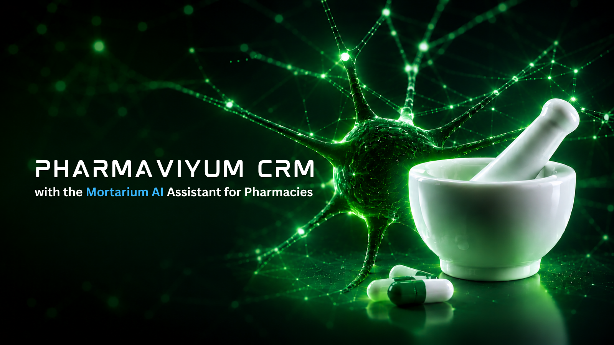

<p align="center">
  
</p>

# Pharmaviyum — Pharmacy ERP/CRM

      

> An integrated pharmacy ERP/CRM foundation for pharmacy operations, dispensing, point of sale, inventory, procurement, and AI-assisted decision support.

## Overview

**Pharmaviyum** is a pharmacy-focused ERP/CRM platform with an integrated AI layer, **Mortarium**.

The platform brings connected workflows for patients, prescriptions, product reference, POS, dispensing, procurement, suppliers, goods receiving, inventory, batches, expiry control, FEFO handling, stock transfers, and audit trails into one application architecture.

Its pilot-first approach is intended to support gradual adoption alongside existing pharmacy systems, rather than requiring an immediate replacement.

The canonical integration branch is `main`. Changes are reviewed through pull requests and validated by GitHub Actions before merge. Production deployment is a separate, manually approved release process.

## At a Glance

- **Application:** FastAPI backend with a React, TypeScript, and Vite frontend.
- **Pharmacy domain:** POS, dispensing, product reference, inventory, procurement, and pharmacy operations.
- **AI layer:** Mortarium, with LangGraph-based RAG and MCP integration.
- **Infrastructure:** PostgreSQL, Redis-compatible services, Docker, and Pharmacy Edge automation.
- **Delivery:** GitHub Actions CI with a separately controlled FastAPI Cloud deployment workflow.

## Contents

- [Overview](#overview)
- [Repository Structure](#repository-structure)
- [Core Pharmacy Workflow](#core-pharmacy-workflow)
- [Core Capabilities](#core-capabilities)
- [Architecture](#architecture)
- [Technology Stack](#technology-stack)
- [RAG Evaluation & Quality](#rag-evaluation--quality)
- [Observability](#observability)
- [AI / RAG Architecture](#ai--rag-architecture)
- [Pharmacy Edge Automation](#pharmacy-edge-automation-ansible)
- [Project Structure](#project-structure)
- [Deployment](#deployment)
- [Development](#development)
- [Quality & CI](#quality--ci)
- [Testing](#testing)
- [Docker](#docker)
- [Security & Data Handling](#security--data-handling)
- [Project Status](#project-status)
- [Documentation](#documentation)
- [Demo / NDA Notice](#demo--nda-notice)
- [License / NDA / Contact](#license--nda--contact)

## Repository Structure

The repository follows clearly defined architectural boundaries and directory ownership rules to keep the codebase consistent, maintainable, and easy to navigate.

The **[Repository Structure Guide](docs/architecture/repository-structure.md)** is the source of truth for:

- Directory responsibilities and ownership.
- Where application code, infrastructure, tests, and documentation belong.
- Rules for adding new files and organizing new components.
- Safe procedures for moving, renaming, or removing existing files.
- Repository-wide conventions for keeping tooling and deployment references in sync.

Review this guide before introducing new directories or changing the location of existing files. Any structural change must update affected imports, CI workflows, Docker and Compose definitions, deployment assets, scripts, and documentation in the same change.

## Core Pharmacy Workflow

The workflow connects the pharmacy's clinical, commercial, and inventory operations. A typical domain flow is:

```text
Patients / Prescriptions
        |
        v
Products / Drug Reference
        |
        v
POS / Orders / Dispensing
        |
        v
Inventory / Batches / FEFO
        |
        +------------------+
        |                  |
        v                  v
Procurement          Stock Transfers
        |                  |
        v                  v
Suppliers / Receiving  Pharmacy Network
        |
        v
Expiry / Quarantine / Audit
```

These are connected domain workflows: a sale or dispensing event affects stock and traceability, while procurement and receiving replenish inventory through auditable transactions.

## Core Capabilities

Pharmaviyum follows a **pilot-first, offline-capable** operating model. The documented initial Pharmacy Edge rollout is limited to 1–10 sites. A 100-site fleet is a future architecture objective, not a validated production capacity.

### Pharmacy Operations

- Patient and customer workflows
- Prescription and dispensing workflows
- POS and order processing
- Patient purchase history
- Pharmacy and tenant context
- Audit logging and transaction traceability

### Pharmacy Edge & Offline Operations

- Pharmacy-local Edge deployment for site-level operational continuity
- Local POS and inventory workflows designed to continue during WAN/Central outages, subject to workflow-specific policy
- Durable outbox-based synchronization with Central when connectivity returns
- Per-pharmacy site identity and credentials
- Explicit separation between supported, restricted, online-only, and validation-blocked offline workflows
- Ansible-based infrastructure automation for controlled Edge host provisioning, deployment, backup, restore drills, and rollback

Offline behavior is policy-controlled, not universal. Local persistence does not make an unavailable payment provider, fiscal authority, e-prescription service, or other external authority available. Consult the [Pharmacy Offline Capability Matrix](docs/devops/PHARMACY_OFFLINE_CAPABILITY_MATRIX.md) before treating any workflow as available offline.

### Inventory Management

- Product and batch management
- FEFO-aware stock handling
- Inventory transactions
- Expiry monitoring and control
- Expired-stock quarantine
- Storage locations
- Temperature logging
- Stock transfers between pharmacies

### Procurement & Supply

- Suppliers and supplier products
- Purchase orders
- Goods receiving
- Batch-aware inventory receiving
- Defectura / stock replenishment workflows
- Procurement-to-inventory traceability

### Product & Drug Reference

Pharmaviyum separates the international drug reference layer from local pharmacy products.

The intended relationship is:

```text
Drug Reference / INN / ATC
            |
            v
     Medicinal Products
            |
            v
     Local Products
            |
            v
      Batches / FEFO / POS
```

Searching by an active ingredient or INN, such as **Omeprazole**, can provide a reference product and related generic products without mixing the reference/original and generic concepts into a single product record.

### Mortarium AI

**Mortarium** is the AI layer of Pharmaviyum.

It is designed to work with authorized pharmacy application context rather than functioning as a generic chatbot.

Current architectural areas include:

- Retrieval-Augmented Generation (RAG)
- Pharmacy-scoped retrieval
- Source-aware answers and citations
- Dialogue and conversation context
- Guardrails and validation
- MCP tools and resources
- LangGraph orchestration
- AI-assisted analytics and forecasting
- Application observability (OpenTelemetry traces + Prometheus metrics)
- Access-controlled AI workflows
- Offline RAG evaluation with Ragas plus pharmaceutical-specific checks for citation support, medication entities, negation, patient-context isolation, and Russian/English retrieval

The pharmacist remains the professional decision-maker. Mortarium provides decision support; it does not authorize dispensing, replace professional judgment, or serve as an independent clinical authority.

## Architecture

```text
                         +----------------------+
                         |   React 19 Frontend  |
                         | TypeScript / Vite 8  |
                         +----------+-----------+
                                    |
                                    v
                         +----------------------+
                         |     FastAPI API      |
                         | Auth / Tenant / API |
                         +----------+-----------+
                                    |
             +----------------------+----------------------+
             |                      |                      |
             v                      v                      v
      +-------------+        +-------------+        +-------------+
      | PostgreSQL  |        | Valkey/Redis |       | Mortarium   |
      | + pgvector  |        | cache/state |        | AI / RAG    |
      +-------------+        +-------------+        +------+------+
                                                           |
                                                  +--------+--------+
                                                  | LLM / AI Tools  |
                                                  +-----------------+

                         Background processing
                                  |
                                  v
                           Celery worker
```

The main backend lives under `src/pharmaviyum`.

The application combines a FastAPI backend, PostgreSQL/pgvector, Redis-compatible caching/state infrastructure, a React frontend, background processing, and the Mortarium AI/RAG layer.

## Technology Stack & Glossary

This section explains not only which technologies are present, but why Pharmaviyum uses them and which part of the system they serve. The version numbers are repository declarations; they do not, by themselves, prove that a dependency is active in every production environment.

### 1. Backend and API

| Technology | Definition | Why Pharmaviyum uses it |
|---|---|---|
| **Python 3.15** | High-level, general-purpose programming language. | Implements the backend, pharmacy domain rules, integrations, background jobs and Mortarium AI services. The project requires Python `>=3.15,<3.16`; CI/Docker target Python 3.15.2. |
| **FastAPI 0.162.5** | Python framework for building APIs using type hints and ASGI. | Exposes the ERP/CRM and AI endpoints, validates requests, applies dependency-based authorization and publishes the OpenAPI contract. |
| **Uvicorn 0.54.0** | ASGI web server. | Runs the FastAPI application and handles asynchronous HTTP connections. FastAPI is the application framework; Uvicorn is the server process. |
| **Pydantic 2.14.3** | Data validation and serialization library. | Defines and validates request/response schemas and structured configuration data, including medication-related fields. |
| **Pydantic Settings 2.16.2** | Settings management built on Pydantic. | Loads typed application configuration from environment variables and supported settings sources. Secrets belong in the deployment secret store, not in source control. |
| **SQLAlchemy 2.1.8** | Python SQL toolkit and object-relational mapper (ORM). | Maps pharmacy domain objects to relational tables and provides controlled SQL queries and transactions. |
| **Alembic 1.20.1** | Database schema migration tool for SQLAlchemy. | Versions schema changes and applies reviewed database migrations. It does not automatically upgrade production just because code is deployed. |
| **asyncpg 0.32.0** | Asynchronous PostgreSQL driver for Python. | Provides async database connectivity for application paths that use the native async PostgreSQL driver. |
| **psycopg 3.3.9** | PostgreSQL adapter for Python. | Provides PostgreSQL connectivity for synchronous or supported async database/tooling paths. |
| **OpenAPI** | Machine-readable API description standard. | Documents FastAPI endpoints and supports generated frontend API clients and integration tooling. |

### 2. Data layer and persistence

| Technology | Definition | Why Pharmaviyum uses it |
|---|---|---|
| **PostgreSQL** | Open-source relational database management system (RDBMS). | Primary structured data store and source of truth for pharmacy operations: users, pharmacies, products, prescriptions, orders, inventory, batches, suppliers and audit records. Relational constraints and transactions protect consistency. |
| **pgvector 0.8.7** | PostgreSQL extension that adds vector data types and similarity-search operations. | Stores and searches embedding vectors alongside authorized document/chunk metadata for semantic retrieval in Mortarium RAG. It extends PostgreSQL; it is not a separate database. |
| **Redis** | In-memory data structure server used for low-latency data access and coordination. | Supports cache, short-lived state and infrastructure coordination where configured. It is not the authoritative store for pharmacy transactions. |
| **Valkey** | Open-source, Redis-compatible in-memory data store. | Used by the separate Pharmacy Edge Ansible deployment profile. It is intentionally documented separately from the local Redis service. |
| **Redis Python client 8.1.0** | Python client library for Redis-compatible servers. | Lets backend services and workers communicate with configured Redis-compatible infrastructure. |
| **PostgreSQL full-text search** | Database-native lexical search over textual documents. | Complements vector similarity in hybrid RAG retrieval, helping exact medication terms, identifiers and phrases remain searchable. |

**Environment boundary:** PostgreSQL 18 with pgvector 0.8.7 and Redis 8.8.4 are disposable development/CI Compose targets. The production Compose profile remains on PostgreSQL 16 and Redis 7; managed production services are not upgraded by changing local container images. The Pharmacy Edge profile uses its separately managed PostgreSQL/Valkey configuration. See [Technology Stack and Version Policy](docs/technology-stack.md).

### 3. Background jobs and asynchronous processing

| Technology | Definition | Why Pharmaviyum uses it |
|---|---|---|
| **Celery 5.6.3** | Distributed task queue for executing work outside the HTTP request lifecycle. | Runs bounded background jobs such as document ingestion and processing, embedding/indexing tasks and other work that should not block an API response. |
| **Celery worker** | A process that consumes and executes queued Celery tasks. | Separates long-running or retryable work from the FastAPI web process and allows worker capacity to be scaled independently. |
| **Redis broker/backend (when configured)** | Redis-compatible transport/state service used by Celery deployments. | Carries queued task messages and/or task results according to the configured Celery topology. The exact broker and result-backend URLs are deployment configuration, not hard-coded assumptions. |

### 4. Frontend and user interface

| Technology | Definition | Why Pharmaviyum uses it |
|---|---|---|
| **React 19.3** | JavaScript library for building component-based user interfaces. | Builds the pharmacy ERP/CRM screens, dashboards, POS and operational workflows. |
| **TypeScript 6.0.x** | JavaScript superset with static type checking. | Detects many interface and data-contract errors during development and makes frontend code easier to maintain. |
| **Vite 8.x** | Frontend development server and build tool. | Provides fast local development, asset processing and optimized production bundles. |
| **Tailwind CSS 4.x** | Utility-first CSS framework. | Implements the responsive design system, layout, spacing, typography, colors and themes. |
| **shadcn/ui approach + Radix UI** | Composable UI component pattern built with accessible primitives; shadcn components are maintained in the application rather than treated as a remote component runtime. | Provides consistent, accessible forms, dialogs, menus, tables and dashboard components while allowing Pharmaviyum-specific customization. |
| **TanStack Query 5.x** | Server-state fetching, caching and synchronization library for React. | Manages API data, loading/error states, cache invalidation and refetching for screens backed by FastAPI. |
| **TanStack Router 1.x** | Type-safe routing library for React. | Defines frontend routes, route parameters, nested layouts and navigation. |
| **Axios 1.x** | Promise-based HTTP client. | Sends frontend requests to the FastAPI API and centralizes request/response handling. |
| **Zod 4.x** | TypeScript-first schema validation library. | Validates frontend data and form payloads at runtime and can share validation intent with TypeScript types. |
| **React Hook Form 7.x** | React form-state and validation library. | Manages complex forms with less unnecessary rendering, including operational and catalog forms. |
| **Zustand 5.x** | Lightweight state-management library. | Holds client-side UI state that does not belong in server-state caching. |
| **Recharts 3.x** | React charting library. | Renders operational dashboards, inventory trends and business metrics. |
| **Vitest 4.x** | Test runner designed for modern Vite projects. | Runs frontend unit/component tests. |
| **Playwright 1.59.1** | Browser automation and end-to-end testing framework. | Exercises real browser workflows such as navigation, forms and critical user journeys. |

### 5. Mortarium AI, LLM and agent architecture

**Mortarium** is the pharmacist-facing AI decision-support layer inside Pharmaviyum. It uses authorized application context and evidence retrieval to help pharmacy professionals find, summarize and interpret relevant information. It is advisory: deterministic application services retain control over permissions, calculations, inventory, payments and dispensing decisions.

| Technology / concept | Definition | Why Pharmaviyum uses it |
|---|---|---|
| **AI layer** | The application subsystem that combines models, retrieval, orchestration, tools, policy checks and evaluation. | Gives pharmacists a controlled AI assistant integrated with ERP workflows rather than an isolated general-purpose chatbot. |
| **LLM (Large Language Model)** | A model trained to understand and generate natural language. | Interprets pharmacist questions, summarizes retrieved evidence and produces structured, source-aware responses. Model/provider selection is configuration-driven; a model name must be taken from the active deployment configuration, not inferred from a library list. |
| **QwenCloud** | Configured model-provider profile used by the current demo setup. | Supplies language-model inference for the demo profile. The demo provider setting must not be confused with proof of the production provider/model or its availability. |
| **LangChain 1.4.0** | Framework and abstractions for composing model, prompt, retriever and tool integrations. | Provides integration building blocks used by the AI layer. It is not itself the agent workflow engine or the database. |
| **LangGraph 1.2.21** | Graph-based orchestration framework for stateful, multi-step LLM workflows. | Coordinates Mortarium agent and RAG stages, conditional routing, tool decisions, bounded retries and checkpointed workflow state. |
| **Agent** | A controlled software workflow in which a model can select among permitted next steps or tools. | Lets Mortarium decide whether a question needs retrieval, a response from supplied context or an authorized read-only tool. Server-side policy—not the model—decides what is permitted. |
| **Agent Harness** | The application control layer around model/agent execution: input validation, authorization context, bounded memory, prompt/cache policy, model routing, output validation and telemetry. | Provides consistent safety and operational controls around LangGraph and LLM calls. In this project it is an architectural/application layer, not a claim that a separate product named “Harness AI” has been installed. |
| **RAG (Retrieval-Augmented Generation)** | A pattern that retrieves relevant source material and supplies it to an LLM before it generates an answer. | Grounds pharmacy answers in approved documents and indexed knowledge instead of relying only on model parameters. The intended response preserves source IDs/citations and authorization scope. |
| **Embeddings** | Numeric vector representations of text that capture semantic relationships. | Represent document chunks and queries so semantically related pharmacy information can be found even when wording differs. The exact embedding model must be read from active runtime configuration. |
| **Vector search** | Similarity search over embedding vectors. | Finds semantically related chunks for RAG. |
| **Hybrid search** | Combination of lexical/full-text retrieval and vector similarity retrieval. | Balances exact medication names, strengths and identifiers with semantically related text. |
| **Chunking** | Splitting source documents into smaller, retrievable passages while retaining useful context and metadata. | Keeps retrieved context within model limits and improves relevance. The current MedicalChunker supports medical-heading heuristics, sentence grouping and recursive fallback; its token estimate is approximate, not a tokenizer-exact count. |
| **Metadata filtering** | Restricting retrieval using trusted attributes such as pharmacy, access level, language and document source. | Prevents cross-pharmacy retrieval and excludes patient-level material unless the authenticated request has the matching patient scope. Missing or invalid scope must fail closed. |
| **MCP (Model Context Protocol)** | A protocol for exposing tools and resources to AI applications through a defined client/server contract; this project documents a JSON-RPC-based MCP layer. | Gives Mortarium a controlled way to discover and invoke approved pharmacy operations. Tool availability is role-filtered and server-authorized; model-generated arguments never establish identity or permission. |
| **Prompt/context engineering** | Designing instructions and selecting trusted context supplied to a model. | Keeps the assistant focused on the pharmacist's task, jurisdiction, language, selected patient scope and evidence budget. |
| **Guardrails** | Input/output checks and policy constraints around model behavior. | Rejects invalid scope, limits unsafe tool use, checks response structure and supports safe abstention when evidence is missing or conflicting. |
| **Ragas 0.4.3** | Framework for evaluating RAG quality using reference data and evaluator models. | Measures offline signals such as faithfulness, answer relevancy, context precision and context recall. It is an evaluation dependency, not part of the production request path. |
| **Pharmaceutical quality metrics** | Domain-specific checks beyond generic LLM scores. | Tests citation support, medication name/strength/form, negation preservation, unsupported clinical claims, patient isolation and English/Russian retrieval. These are regression checks, not clinical certification. |

**Important AI boundary:** RAG and agent workflows do not make an answer clinically authoritative. Patient and pharmacy authorization is enforced by application code and retrieval filters. The pharmacist remains responsible for professional decisions. See [Mortarium AI system design](docs/ai/AI_LLM_SYSTEM_DESIGN.md), [chunking pipeline](docs/ai/chunking-pipeline.md) and [Ragas evaluation](docs/ai/ragas-pharmaceutical-evaluation.md).

### 6. Observability and operations

| Technology | Definition | Why Pharmaviyum uses it |
|---|---|---|
| **OpenTelemetry 1.45.2** | Vendor-neutral APIs, SDKs and conventions for telemetry, especially distributed traces. | Tracks bounded spans across API and Mortarium workflows so latency and failures can be investigated. Sensitive prompts, patient data, tokens and retrieved clinical text must not be attached to spans. |
| **OTLP** | OpenTelemetry Protocol for exporting telemetry to a collector/backend. | Transports traces from the application to a configured telemetry collector. SDK presence alone does not prove that production traces are being delivered. |
| **Prometheus** | Metrics collection and time-series monitoring system. | Collects numeric service metrics such as request counts, error rates, queue depth and latency histograms. Labels must remain low-cardinality and must not contain patient/user identifiers. |
| **Grafana** | Dashboard and visualization platform for metrics and other telemetry sources. | Displays operational dashboards and supports investigation of service health and performance. |
| **Jaeger** | Distributed tracing backend and trace UI. | Provides a local trace viewer for inspecting spans and request relationships in the development Compose stack. |
| **OpenTelemetry Collector** | Vendor-neutral service that receives, processes and exports telemetry. | Separates application instrumentation from the final trace backend and provides a controlled telemetry pipeline. |
| **Structured application logs** | Machine-readable event records with consistent fields. | Helps correlate failures and operational events without logging secrets, patient details or full clinical payloads. |
| **Health/readiness checks** | Endpoints that report process health and dependency readiness. | Distinguish a running web process from an application whose required dependencies are ready. |

The repository includes local observability infrastructure. Production trace delivery, alert routing and end-to-end coverage require a configured collector/backend and live verification; they must not be inferred from local Compose files.

### 7. Infrastructure, delivery and developer tooling

| Technology | Definition | Why Pharmaviyum uses it |
|---|---|---|
| **Docker** | Platform for packaging applications and dependencies into containers. | Produces repeatable runtime images for the API and supporting processes. |
| **Docker Compose** | Tool for defining and running multi-container applications. | Starts disposable local development/test dependencies such as PostgreSQL, Redis, workers and local observability services. |
| **FastAPI Cloud** | Managed hosting/deployment platform for the FastAPI application. | Hosts the deployed Pharmaviyum backend. Deployment and production migrations are controlled release steps, not automatic side effects of a README change or CI pass. |
| **GitHub** | Source-control and collaboration platform. | Hosts the repository, branches, pull requests, code review and release history. |
| **GitHub Actions** | CI/CD automation service integrated with GitHub. | Runs lint, formatting, type checks, tests, security scans and build validation. Passing CI is a quality signal; it does not itself prove production health. |
| **uv 0.13.8** | Fast Python package manager and project/environment tool. | Installs Python dependencies, runs commands and keeps the resolved dependency set reproducible using `pyproject.toml` and `uv.lock`. |
| **Bun 1.4.4** | JavaScript runtime, package manager and frontend toolchain. | Installs frontend dependencies and runs frontend scripts for development, builds and tests. |
| **Ansible** | Agentless infrastructure automation tool. | Provisions and operates Pharmacy Edge hosts using reviewed playbooks and roles. It is infrastructure automation, not the ERP's application business logic. |
| **Mailpit 1.33.1** | Local SMTP capture and email testing tool. | Captures development emails so password recovery and notification flows can be tested without sending real messages. Production SMTP is configured separately. |

### 8. Testing, quality and security tooling

| Technology | Definition | Why Pharmaviyum uses it |
|---|---|---|
| **Pytest 9.2.0** | Python testing framework. | Tests backend business logic, API behavior, database integration, AI/RAG behavior and security invariants. |
| **pytest-asyncio** | Pytest plugin for asynchronous tests. | Exercises async FastAPI, database and service code. |
| **pytest-cov** | Pytest coverage plugin. | Measures which code paths are exercised by the test suite. Coverage is a measurement, not proof that behavior is correct. |
| **Ruff** | Fast Python linter and code-quality tool. | Detects common defects and enforces selected lint rules. |
| **Black** | Opinionated Python code formatter. | Keeps Python formatting consistent. |
| **isort** | Python import sorter. | Keeps imports ordered consistently. |
| **mypy** | Static type checker for Python. | Finds type inconsistencies before runtime. |
| **Bandit** | Static security analysis tool for Python. | Flags selected risky code patterns for review. |
| **pip-audit** | Python dependency vulnerability checker. | Checks installed/declarative Python dependencies against known vulnerability advisories. |
| **ESLint** | JavaScript/TypeScript linter. | Finds frontend code-quality and common correctness issues. |
| **Prettier** | Code formatter for frontend and supported text/config files. | Keeps frontend formatting consistent. |
| **Playwright** | Browser-based end-to-end testing tool. | Validates complete user journeys in a real browser rather than testing isolated functions only. |

### Dependency source of truth

Python dependency definitions are maintained in:

- `pyproject.toml` — direct dependencies, optional groups and tool configuration.
- `uv.lock` — resolved, reproducible Python dependency versions.
- `requirements-eval.txt` — isolated offline Ragas evaluation dependencies; not installed in the production runtime image.

Frontend dependency definitions are maintained in:

- `frontend/shadcn-admin/package.json` — frontend dependencies and scripts.
- `frontend/shadcn-admin/bun.lock` — resolved frontend dependency versions.

Do not maintain a second authoritative Python dependency list. Change dependencies in their source manifests, regenerate the relevant lockfile and run the corresponding CI checks.

For exact declared versions, environment boundaries and the upgrade procedure, see [docs/technology-stack.md](docs/technology-stack.md).

## RAG Evaluation & Quality

RAG orchestration uses LangGraph. Ragas is isolated to offline evaluation and is not imported into the production request path. Evaluation includes standard Ragas measures (faithfulness, answer relevancy, context precision/recall) and domain-specific regression checks for citation correctness, medication name/strength/form, negation preservation, clinical hallucinations, patient/pharmacy isolation, and Russian/English retrieval. LLM-judge scores are regression signals—not clinical validation or regulatory certification. Evaluation datasets must be synthetic or de-identified.

See [`docs/ai/ragas-pharmaceutical-evaluation.md`](docs/ai/ragas-pharmaceutical-evaluation.md), the [hallucination detection and red-team strategy](docs/ai/hallucination-detection-and-red-team.md), and the [Mortarium chunking pipeline](docs/ai/chunking-pipeline.md). DeepEval is isolated to evaluation dependencies; HHEM is documented as an optional evaluator; Promptfoo is intended for controlled red-team scans against non-production targets. None is represented as a production response gate until runtime enforcement is implemented and tested. The current chunker supports medical/section-heuristic, sentence-grouping and recursive strategies; parent-child retrieval, table-aware parsing and tokenizer-accurate chunk budgets are documented as target capabilities, not assumed to be complete.

## Observability

The application uses the OpenTelemetry SDK for distributed tracing. Automatic FastAPI, SQLAlchemy, and HTTPX instrumentation is disabled by default and requires an explicit development/test opt-in; Redis command auto-instrumentation remains disabled. Configure tracing with `OTEL_ENABLED=true` and `OTEL_EXPORTER_OTLP_ENDPOINT`. See [`docs/observability/opentelemetry.md`](docs/observability/opentelemetry.md) for instrumentation boundaries, sampling, and data-protection requirements.

## AI / RAG Architecture

The AI layer is implemented under `src/pharmaviyum/ai` and exposed through the FastAPI application.

The RAG pipeline follows the general flow:

```text
Query
  -> transform_query
  -> retrieve
  -> grade_documents
  -> compress
  -> generate
  -> guardrails
```

Key design properties include:

- retrieval scoped to the authenticated pharmacy/tenant context;
- patient-specific access controls where applicable;
- country and language carried through query context;
- retrieved documents treated as untrusted input before generation;
- stable source identifiers for citations;
- explicit conversation/checkpoint scope;
- low-cardinality observability labels.

Detailed AI architecture is documented in [`docs/ai_architecture.md`](docs/ai_architecture.md).

## Pharmacy Edge Automation (Ansible)

The repository includes an Ansible operations layer under `ansible/` for controlled Pharmacy Edge infrastructure management. It is separate from application business logic and does not replace the application Sync Engine.

Current repository assets include deployment, migration, backup, restore, rollback, fleet-validation playbooks, reusable roles, a lab inventory, and Ansible CI quality checks. The operating guardrails are:

- Active rollout limit: **10 pharmacy sites**, with serial/fail-fast deployment.
- Future architecture objective: **up to 100 sites**; this is not a claim of completed fleet validation.
- Unique pharmacy/site identity and per-site credentials; secrets belong in an approved secret manager or encrypted runtime variables.
- Immutable application image references and pinned infrastructure package versions.
- Database migrations and restore operations require separate review and approval.
- A repository playbook is not proof of a successful real-site deployment; lab and pharmacy acceptance evidence is required.

See [`docs/devops/ANSIBLE_PHARMACY_EDGE_GUIDE.md`](docs/devops/ANSIBLE_PHARMACY_EDGE_GUIDE.md) and [`docs/devops/PHARMACY_EDGE_ANSIBLE_ROLLOUT.md`](docs/devops/PHARMACY_EDGE_ANSIBLE_ROLLOUT.md).

## Project Structure

The repository is organized by responsibility, with clear boundaries between application code, frontend, database migrations, infrastructure automation, tests, and documentation.

| Path | Responsibility |
|---|---|
| `src/pharmaviyum/` | FastAPI application, domain logic, integrations, and Mortarium AI |
| `frontend/shadcn-admin/` | React, TypeScript, Vite, and shadcn-based admin interface |
| `alembic/` | Database schema migrations |
| `ansible/` | Pharmacy Edge infrastructure automation |
| `docker/`, `deploy/`, and Compose files | Container and deployment assets |
| `tests/` | Automated backend and cross-layer tests |
| `docs/` | Architecture decisions, engineering guides, and operational runbooks |

For directory ownership, root-level configuration rules, and safe file-movement procedures, use the canonical [Repository Structure Guide](docs/architecture/repository-structure.md).

## Deployment

The hosted application target is **FastAPI Cloud**. Production deployment is intentionally manual: merging to `main` or passing CI does not deploy the application or run production migrations. The release workflow verifies CI for the exact selected commit before deployment. See [`docs/deployment/FASTAPI_CLOUD.md`](docs/deployment/FASTAPI_CLOUD.md) for secrets, environment configuration, release steps, smoke checks, and rollback constraints.

## Development

### Prerequisites

- Python 3.15 (project constraint: `>=3.15,<3.16`; Docker/CI validate 3.15.2)
- `uv` for Python dependency installation and execution
- Docker and Docker Compose
- Bun for the frontend toolchain

### Backend

Preferred development workflow uses `uv`:

```bash
uv sync
uv run alembic upgrade head
uv run uvicorn src.pharmaviyum.main:app --reload --port 8000
```

Local API documentation:

- Swagger UI: `http://localhost:8000/docs`
- OpenAPI JSON: `http://localhost:8000/openapi.json`
- Metrics: `http://localhost:8000/metrics`

### Frontend

```bash
cd frontend/shadcn-admin
bun install
bun run dev
```

Frontend scripts include build, unit tests, E2E tests, linting, and OpenAPI client generation.

## Quality & CI

GitHub Actions is the primary CI system.

Quality gates cover:

- Ruff
- Black
- isort
- MyPy
- pytest
- security checks
- build and integration verification where applicable

Typical Python checks:

```bash
uv run ruff check .
uv run black --check .
uv run isort --check-only .
uv run mypy --explicit-package-bases src
uv run pytest
```

CI is treated as a required engineering gate. Changes should remain focused, dependency upgrades should be validated incrementally, and documentation changes should not be mixed with unrelated implementation changes.

## Testing

Backend tests:

```bash
uv run pytest
```

Frontend tests:

```bash
cd frontend/shadcn-admin
bun run test
bun run test:e2e
```

Production-oriented frontend build:

```bash
cd frontend/shadcn-admin
bun run build
```

## Docker

The default local development Compose stack uses PostgreSQL 18 with pgvector 0.8.7 and Redis 8.8.4, alongside the application and supporting services. These are disposable development targets—not production upgrades.

Typical services include:

- PostgreSQL 18 with pgvector 0.8.7
- Redis 8.8.4 for cache/state
- FastAPI API
- Celery background worker
- Ollama and local observability services where configured

The separate docker-compose.prod.yml profile remains on PostgreSQL 16 and Redis 7. Managed production databases/caches and Pharmacy Edge PostgreSQL 16/Valkey are separate environments; changing the development Compose images does not migrate or upgrade them.

Start the development stack with:

```bash
docker compose up --build
```

The React frontend can be developed separately using the frontend commands above.

## Security & Data Handling

Security is treated as a cross-cutting concern across the application.

- Authentication and authorization are part of the application boundary.
- Pharmacy/tenant isolation is enforced before protected retrieval and AI operations.
- Patient-specific data is subject to access control and filtering.
- Retrieved documents are considered untrusted input.
- AI output is not treated as an authoritative source of truth.
- Audit and transaction records support operational traceability.
- Observability avoids unnecessary high-cardinality identifiers.
- Demo data is synthetic and does not represent real client records.

## Project Status

**Canonical branch:** `main`

**Current stage:** Pharmacy ERP Foundation + Production Hardening

The project is under active engineering development. Current work focuses on hardening the ERP/POS workflows, establishing the Pharmacy Edge and Central synchronization contract, validating the Ansible rollout for 1–10 sites, and improving Mortarium AI/RAG evaluation. The 100-site fleet is an architecture target only. A successful CI run or application deployment does not, by itself, establish production readiness; live smoke tests, site acceptance, recovery drills, and capacity evidence remain necessary.

The development approach is **pilot-first**: where appropriate, Pharmaviyum can integrate alongside existing pharmacy ERP systems before broader replacement or migration decisions.

## Documentation

Additional technical documentation is available under `docs/`, including:

- [`docs/README.md`](docs/README.md) — documentation index
- [`docs/devops/ANSIBLE_PHARMACY_EDGE_GUIDE.md`](docs/devops/ANSIBLE_PHARMACY_EDGE_GUIDE.md) — Ansible operating guide for Pharmacy Edge
- [`docs/devops/PHARMACY_EDGE_ANSIBLE_ROLLOUT.md`](docs/devops/PHARMACY_EDGE_ANSIBLE_ROLLOUT.md) — 1–10 rollout guardrails and future 100-site architecture target
- [`docs/devops/PHARMACY_OFFLINE_CAPABILITY_MATRIX.md`](docs/devops/PHARMACY_OFFLINE_CAPABILITY_MATRIX.md) — workflow-by-workflow offline policy and limitations
- [`docs/ai/ragas-pharmaceutical-evaluation.md`](docs/ai/ragas-pharmaceutical-evaluation.md) — Ragas and pharmaceutical RAG evaluation contract
- [Pharmacy workflow documentation](docs/workflows/README.md)
- [System architecture and component boundaries](docs/architecture/system-context.md)
- [AI / LLM system design](docs/ai/AI_LLM_SYSTEM_DESIGN.md)
- [Architecture Decision Records (ADRs)](docs/adr/README.md)
- [Development and testing handbook](docs/guides/DEVELOPMENT_AND_TESTING.md)
- [Production operations and recovery runbook](docs/operations/PRODUCTION_OPERATIONS_RUNBOOK.md)
- [Release runbook](docs/operations/RELEASE_RUNBOOK.md)
- [DevOps roadmap and engineering stages](docs/devops/ENGINEERING_ROADMAP.md)
- [WebSocket protocol](docs/websocket-protocol.md)

## Demo / NDA Notice

This repository is intended for technical evaluation and architectural review.

- Demo data is synthetic.
- No real client data is included.
- Proprietary production integrations and business logic are not exposed here.
- Access and redistribution are subject to the applicable NDA and author permission.

### Legal Notice

This project and its contents are protected by applicable confidentiality and NDA obligations. The repository must not be copied, redistributed, or used outside the permitted evaluation scope without explicit written permission from the author.

## License / NDA / Contact

This repository is not currently presented as an open-source project. Usage, copying, redistribution, and access are governed by the applicable NDA and explicit permission from the author.

For technical walkthroughs, architectural discussion, or evaluation access, contact the repository owner through the private project channel.

© 2026 Pharmaviyum. All rights reserved.
