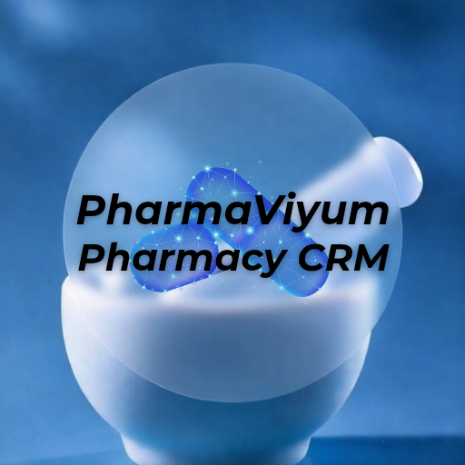

  

  

**PharmaViyum** is a CRM platform for pharmacies, designed to integrate with existing ERP systems and support pharmacists in client-oriented workflows, order handling, and analytical insights.

**Core purpose:** centralize client interactions, support pharmacy operations, and enhance service quality without replacing core ERP systems.

## Demo Repository Notice

This repository provides a **demo branch** derived from the production codebase.  

The demo is safe, NDA-compliant, and uses **synthetic client and order data**.  
No real client data or proprietary logic is included.

## Project Versions

**Production (`main` / `production`)**  
🔹 Full internal codebase with real integrations and proprietary business logic  
🔹 Uses production PostgreSQL database with real operational data  
🔹 Private access only  

**Demo (`demo`)**  
🔹 Safe demonstration version for evaluation and review  
🔹 Uses PostgreSQL with fake and test data  
🔹 Proprietary business logic is abstracted  
🔹 Shared only with the author’s permission  
🔹 Periodically synchronized from production to reflect current architecture  

## MVP Demo Highlights

The demo version demonstrates:  
🔹 Core CRM workflows and pharmacist-facing interface  
🔹 High-level system and service architecture  
🔹 Abstracted examples of code structure and design patterns  
🔹 RAG module behavior using demo documents only  

This demo is intended for architectural and technical discussion.

## Legal Notice

This project is protected under a **Non-Disclosure Agreement (NDA)**.  
No part of this repository may be copied, distributed, or used beyond evaluation purposes without explicit written permission from the author.  

All demo data is synthetic and used solely for demonstration.

## Contact

For technical walkthroughs, architectural discussion, or evaluation access, please contact:

**[Your Name]**  
your.email@example.com

© 2026 PharmaViyum. All rights reserved.  
Unauthorized use, copying, or distribution is strictly prohibited.  
The demo version is protected under NDA and may only be shared with the author’s permission.
