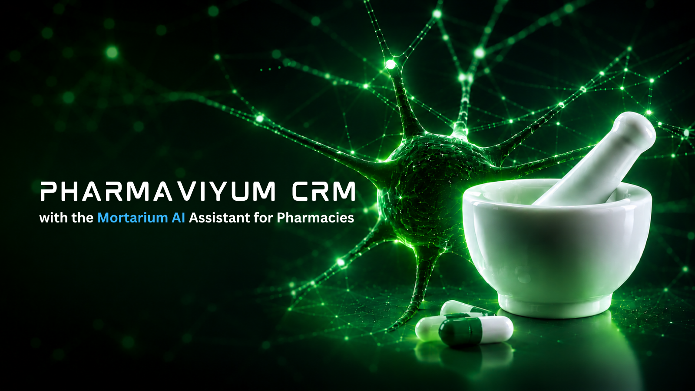

<!-- Russian translation of the canonical English README.md. Keep both versions aligned. -->

<p align="center">
  
</p>

# Pharmaviyum — аптечная ERP/CRM-система

      

[English](README.md) · **Русский**

> Интегрированная основа аптечной ERP/CRM-платформы для управления аптечными процессами, отпуском лекарств, POS-продажами, запасами, закупками и интеллектуальной поддержкой принятия решений с помощью ИИ.

## Обзор

**Pharmaviyum** — ERP/CRM-платформа, ориентированная на аптечный бизнес и включающая интегрированный AI-слой **Mortarium**.

Платформа объединяет в единой архитектуре процессы работы с пациентами и рецептами, справочник лекарственных средств, POS, отпуск препаратов, закупки, поставщиков, приёмку товаров, складской учёт, партии, контроль сроков годности, FEFO, перемещение запасов и аудит операций.

Подход pilot-first предполагает постепенное внедрение платформы параллельно с существующими аптечными системами, а не их немедленную замену.

Каноническая интеграционная ветка — `main`. Изменения проходят проверку через Pull Request и GitHub Actions до слияния. Развёртывание в production является отдельным процессом с ручным подтверждением.

## Кратко о проекте

- **Приложение:** backend на FastAPI и frontend на React, TypeScript и Vite.
- **Аптечная предметная область:** POS, отпуск лекарств, справочник препаратов, склад, закупки и аптечные операции.
- **AI-слой:** Mortarium с RAG на базе LangGraph и интеграцией MCP.
- **Инфраструктура:** PostgreSQL, Redis-совместимые сервисы, Docker и автоматизация Pharmacy Edge.
- **Поставка:** CI в GitHub Actions и отдельный контролируемый workflow развёртывания в FastAPI Cloud.

## Содержание

- [Обзор](#обзор)
- [Структура репозитория](#структура-репозитория)
- [Основной аптечный процесс](#основной-аптечный-процесс)
- [Основные возможности](#основные-возможности)
- [Архитектура](#архитектура)
- [Технологический стек](#технологический-стек)
- [Оценка качества RAG](#оценка-качества-rag)
- [Наблюдаемость](#наблюдаемость)
- [Архитектура AI--RAG](#архитектура-ai--rag)
- [Автоматизация Pharmacy Edge](#автоматизация-pharmacy-edge-ansible)
- [Структура проекта](#структура-проекта)
- [Развёртывание](#развёртывание)
- [Разработка](#разработка)
- [Качество и CI](#качество-и-ci)
- [Тестирование](#тестирование)
- [Docker](#docker)
- [Безопасность и обработка данных](#безопасность-и-обработка-данных)
- [Статус проекта](#статус-проекта)
- [Документация](#документация)
- [Демо и NDA](#демо-и-nda)
- [Лицензия, NDA и контакты](#лицензия-nda-и-контакты)

## Структура репозитория

Репозиторий организован с чёткими архитектурными границами и правилами ответственности каталогов. Это обеспечивает единообразие, сопровождаемость и понятную навигацию по кодовой базе.

**[Руководство по структуре репозитория](docs/architecture/repository-structure.md)** является основным источником информации о:

- назначении каталогов и ответственности за них;
- размещении кода приложения, инфраструктуры, тестов и документации;
- правилах добавления файлов и организации компонентов;
- безопасном перемещении, переименовании и удалении файлов;
- общих правилах синхронизации инструментов, CI и конфигурации развёртывания.

Перед созданием новых каталогов или изменением расположения существующих файлов изучите это руководство. Структурные изменения должны сопровождаться обновлением зависимых импортов, CI workflows, Docker/Compose, deployment assets, скриптов и документации.

## Основной аптечный процесс

Процесс объединяет клинические, коммерческие и складские операции аптеки:

```text
Пациенты / Рецепты
        |
        v
Товары / Справочник лекарств
        |
        v
POS / Заказы / Отпуск
        |
        v
Склад / Партии / FEFO
        |
        +------------------+
        |                  |
        v                  v
Закупки              Перемещение запасов
        |                  |
        v                  v
Поставщики / Приёмка  Аптечная сеть
        |
        v
Сроки годности / Карантин / Аудит
```

Это взаимосвязанные процессы предметной области: продажа или отпуск влияют на остатки и прослеживаемость, а закупки и приёмка пополняют запасы посредством контролируемых и аудируемых операций.

## Основные возможности

Pharmaviyum придерживается модели **pilot-first и offline-capable**. Документированный начальный этап внедрения Pharmacy Edge ограничен 1–10 площадками. Поддержка сети из 100 площадок является будущей архитектурной целью, а не подтверждённой производственной ёмкостью.

### Аптечные операции

- процессы работы с пациентами и клиентами;
- рецепты и отпуск лекарственных средств;
- POS и обработка заказов;
- история покупок пациента;
- контекст аптеки и tenant;
- аудит и прослеживаемость транзакций.

### Pharmacy Edge и автономная работа

- локальное Edge-развёртывание в аптеке для обеспечения непрерывности операций на уровне площадки;
- локальные POS- и складские процессы, рассчитанные на работу при сбоях WAN/Central, с учётом политики каждого процесса;
- надёжная синхронизация с Central через outbox-механизм после восстановления соединения;
- отдельная идентичность и учётные данные каждой аптеки;
- явное разделение автономных процессов на поддерживаемые, ограниченные, доступные только онлайн и заблокированные до завершения проверки;
- автоматизация инфраструктуры с помощью Ansible: подготовка Edge-хостов, развёртывание, резервное копирование, проверка восстановления и откат.

Автономная работа регулируется политиками и не распространяется автоматически на все функции. Локальное хранение данных не обеспечивает доступность недоступного платёжного провайдера, фискального органа, сервиса электронных рецептов или другой внешней системы. Перед признанием процесса доступным offline изучите [матрицу автономных возможностей аптеки](docs/devops/PHARMACY_OFFLINE_CAPABILITY_MATRIX.md).

### Управление запасами

- управление товарами и партиями;
- обработка запасов с учётом FEFO;
- складские транзакции;
- мониторинг и контроль сроков годности;
- карантин просроченных товаров;
- места хранения;
- регистрация температуры;
- перемещение запасов между аптеками.

### Закупки и снабжение

- поставщики и товары поставщиков;
- заказы на закупку;
- приёмка товаров;
- приёмка с учётом партий;
- процессы Defectura и пополнения запасов;
- прослеживаемость от закупки до складского остатка.

### Справочник товаров и лекарственных средств

Pharmaviyum отделяет международный справочный слой лекарственных средств от локальных аптечных товаров.

Предполагаемая связь сущностей:

```text
Справочник лекарств / INN / ATC
              |
              v
       Лекарственные препараты
              |
              v
        Локальные товары
              |
              v
       Партии / FEFO / POS
```

Поиск по действующему веществу или INN, например **Omeprazole**, может возвращать справочный препарат и связанные генерические продукты, не смешивая оригинальный/справочный препарат и генерики в одной товарной записи.

### Mortarium AI

**Mortarium** — AI-слой платформы Pharmaviyum.

Он проектируется для работы с авторизованным контекстом аптечного приложения, а не как универсальный чат-бот.

Основные архитектурные направления:

- Retrieval-Augmented Generation (RAG, генерация с дополнением извлечёнными данными);
- поиск с учётом области доступа аптеки;
- ответы с указанием источников и цитированием;
- контекст диалога и истории взаимодействия;
- защитные механизмы (guardrails) и валидация;
- инструменты и ресурсы MCP;
- оркестрация рабочих процессов через LangGraph;
- аналитика и прогнозирование с поддержкой ИИ;
- наблюдаемость приложения: трассировки OpenTelemetry и метрики Prometheus;
- AI-процессы с контролем доступа;
- автономная оценка RAG с помощью Ragas и специализированные аптечные проверки: подтверждение утверждений источниками, точность лекарственных сущностей, сохранение отрицаний, изоляция контекста пациента и поиск на русском/английском языках.

Профессиональное решение остаётся за фармацевтом. Mortarium предоставляет поддержку принятия решений, но не разрешает отпуск препаратов, не заменяет профессиональное суждение и не является самостоятельным клиническим авторитетом.

## Архитектура

```text
                         +----------------------+
                         |   React 19 Frontend  |
                         | TypeScript / Vite 8  |
                         +----------+-----------+
                                    |
                                    v
                         +----------------------+
                         |     FastAPI API      |
                         | Auth / Tenant / API |
                         +----------+-----------+
                                    |
             +----------------------+----------------------+
             |                      |                      |
             v                      v                      v
      +-------------+        +-------------+        +-------------+
      | PostgreSQL  |        | Valkey/Redis |        | Mortarium   |
      | + pgvector  |        | cache/state |        | AI / RAG    |
      +-------------+        +-------------+        +------+------+
                                                           |
                                                  +--------+--------+
                                                  | LLM / AI Tools  |
                                                  +-----------------+

                    Фоновая обработка
                             |
                             v
                       Celery worker
```

Основной backend находится в `src/pharmaviyum`.

Приложение объединяет backend на FastAPI, PostgreSQL/pgvector, инфраструктуру кэширования и состояния на Redis-совместимых сервисах, React frontend, фоновые задачи и AI/RAG-слой Mortarium.

## Технологический стек

Технологии Pharmaviyum сгруппированы по архитектурным слоям:

- **Backend и API:** Python 3.15, FastAPI, Uvicorn, Pydantic, SQLAlchemy, Alembic, OpenAPI.
- **Данные и хранение:** PostgreSQL, pgvector, Redis; Valkey для отдельного профиля Pharmacy Edge.
- **Фоновые задачи:** Celery и инфраструктура задач на базе Redis-совместимых сервисов.
- **Frontend:** React, TypeScript, Vite, Tailwind CSS, shadcn/ui, Radix UI, TanStack Query/Router.
- **AI / LLM:** Mortarium AI, LangChain, LangGraph, RAG, embeddings, hybrid search, MCP, Agent Harness, Ragas.
- **Наблюдаемость:** OpenTelemetry, OTLP, Prometheus, Grafana, Jaeger, OpenTelemetry Collector.
- **Инфраструктура и поставка:** Docker, Docker Compose, FastAPI Cloud, GitHub Actions, Ansible, uv, Bun.
- **Тестирование и безопасность:** Pytest, Playwright, Vitest, Ruff, Black, isort, mypy, Bandit, pip-audit, ESLint, Prettier.
- **Тестирование электронной почты:** Mailpit.

Полные определения компонентов, их роли, архитектурные границы, заявленные версии, различия окружений и правила обновления зависимостей приведены в [Technology Stack & Glossary](docs/technology-stack.md). Документ является подробным техническим глоссарием; русская версия этого README сохраняет те же архитектурные ссылки и определения назначения технологий.

## Оценка качества RAG

Оркестрация RAG выполняется с помощью LangGraph. Ragas изолирован для автономной оценки и не импортируется в production request path.

Оценка включает стандартные метрики Ragas — faithfulness, answer relevancy, context precision и context recall — и специализированные регрессионные проверки:

- корректность цитирования и подтверждение утверждений источниками;
- точность названия лекарства, дозировки/силы, единиц измерения и лекарственной формы;
- сохранение отрицаний и условных формулировок;
- частота неподтверждённых клинических утверждений;
- изоляция данных пациента и аптеки;
- качество поиска на русском и английском языках.

Оценки LLM-as-a-judge являются сигналами регрессии, а не клинической валидацией или подтверждением соответствия нормативным требованиям. Для наборов оценки используются синтетические или обезличенные данные.

Подробнее: [оценка Ragas для фармацевтической области](docs/ai/ragas-pharmaceutical-evaluation.md), [обнаружение галлюцинаций и red-team стратегия](docs/ai/hallucination-detection-and-red-team.md), [pipeline чанкинга Mortarium](docs/ai/chunking-pipeline.md).

DeepEval изолирован в зависимостях для оценки; HHEM описан как дополнительный evaluator; Promptfoo предназначен для контролируемых red-team проверок на непроизводственных целях. Ни один из этих инструментов не считается production response gate, пока соответствующее runtime-применение не реализовано и не протестировано.

Текущий chunker поддерживает медицинскую/эвристическую сегментацию по разделам, группировку предложений и рекурсивную стратегию. Parent-child retrieval, разбор таблиц и точные бюджеты на основе токенизатора являются целевыми возможностями и не должны считаться реализованными без отдельного подтверждения кодом и тестами.

## Наблюдаемость

Приложение использует OpenTelemetry SDK для распределённой трассировки. Автоматическая инструментация FastAPI, SQLAlchemy и HTTPX по умолчанию отключена и требует явного opt-in для development/test. Автоматическая инструментация команд Redis остаётся отключённой.

Для включения трассировки используются настройки `OTEL_ENABLED=true` и `OTEL_EXPORTER_OTLP_ENDPOINT`.

Подробности об инструментации, sampling и защите данных: [политика OpenTelemetry](docs/observability/opentelemetry.md).

## Архитектура AI / RAG

AI-слой находится в `src/pharmaviyum/ai` и предоставляется через приложение FastAPI.

Общий процесс RAG:

```text
Запрос
  -> transform_query
  -> retrieve
  -> grade_documents
  -> compress
  -> generate
  -> guardrails
```

Ключевые архитектурные свойства:

- поиск ограничивается контекстом аутентифицированной аптеки/tenant;
- доступ к данным конкретного пациента контролируется там, где это применимо;
- страна и язык передаются в контексте запроса;
- найденные документы рассматриваются как недоверенный ввод до передачи модели;
- для цитирования используются стабильные идентификаторы источников;
- область контекста диалога и checkpoint задаётся явно;
- для меток наблюдаемости используются метрики с низкой кардинальностью.

Подробная архитектура: [AI architecture](docs/ai_architecture.md), [Mortarium AI Architecture & Glossary](docs/ai/MORTARIUM_AI_ARCHITECTURE.md), [AI / LLM System Design](docs/ai/AI_LLM_SYSTEM_DESIGN.md).

## Автоматизация Pharmacy Edge (Ansible)

Репозиторий содержит операционный слой Ansible в `ansible/` для контролируемого управления инфраструктурой Pharmacy Edge. Он отделён от бизнес-логики приложения и не заменяет Sync Engine приложения.

В репозитории предусмотрены playbooks для развёртывания, миграций, резервного копирования, восстановления, отката и проверки fleet, повторно используемые роли, lab inventory и проверки качества Ansible в CI.

Основные эксплуатационные ограничения:

- текущий лимит внедрения: **10 аптечных площадок** с последовательным fail-fast развёртыванием;
- будущая архитектурная цель: **до 100 площадок** — это не утверждение о завершённой проверке такой сети;
- уникальная идентичность аптеки/площадки и отдельные credentials для каждой площадки; секреты хранятся в утверждённом secret manager или зашифрованных runtime-переменных;
- неизменяемые ссылки на образы приложения и зафиксированные версии инфраструктурных пакетов;
- миграции базы данных и операции восстановления требуют отдельной проверки и подтверждения;
- наличие playbook в репозитории не доказывает успешное развёртывание на реальной площадке: необходимы результаты лабораторной проверки и приёмки аптекой.

Документация: [руководство Ansible для Pharmacy Edge](docs/devops/ANSIBLE_PHARMACY_EDGE_GUIDE.md) и [план внедрения Pharmacy Edge](docs/devops/PHARMACY_EDGE_ANSIBLE_ROLLOUT.md).

## Структура проекта

Репозиторий организован по зонам ответственности: код приложения, frontend, миграции базы данных, инфраструктурная автоматизация, тесты и документация разделены.

| Путь | Назначение |
|---|---|
| `src/pharmaviyum/` | FastAPI-приложение, доменная логика, интеграции и Mortarium AI |
| `frontend/shadcn-admin/` | Admin-интерфейс на React, TypeScript, Vite и shadcn/ui |
| `alembic/` | Миграции схемы базы данных |
| `ansible/` | Автоматизация инфраструктуры Pharmacy Edge |
| `docker/`, `deploy/` и Compose-файлы | Контейнеры и ресурсы развёртывания |
| `tests/` | Автоматические backend- и межслойные тесты |
| `docs/` | Архитектурные решения, инженерные руководства и эксплуатационные инструкции |

Правила ответственности каталогов, корневой конфигурации и безопасного перемещения файлов описаны в [руководстве по структуре репозитория](docs/architecture/repository-structure.md).

## Развёртывание

Целевая платформа размещения приложения — **FastAPI Cloud**.

Развёртывание production намеренно выполняется вручную: слияние изменений в `main` или успешный CI сами по себе не запускают приложение и не выполняют production-миграции. Release workflow проверяет CI для конкретного выбранного commit перед развёртыванием.

См. [руководство FastAPI Cloud](docs/deployment/FASTAPI_CLOUD.md): секреты, конфигурация окружения, этапы release, smoke checks и ограничения отката.

## Разработка

### Требования

- Python 3.15 (ограничение проекта: `>=3.15,<3.16`; Docker/CI проверяют 3.15.2);
- `uv` для установки и запуска Python-зависимостей;
- Docker и Docker Compose;
- Bun для frontend toolchain.

### Backend

Рекомендуемый workflow разработки использует `uv`:

```bash
uv sync
uv run alembic upgrade head
uv run uvicorn src.pharmaviyum.main:app --reload --port 8000
```

Локальная документация API:

- Swagger UI: `http://localhost:8000/docs`
- OpenAPI JSON: `http://localhost:8000/openapi.json`
- Метрики: `http://localhost:8000/metrics`

### Frontend

```bash
cd frontend/shadcn-admin
bun install
bun run dev
```

Frontend scripts включают production build, unit-тесты, E2E-тесты, linting и генерацию OpenAPI-клиента.

## Качество и CI

Основная система CI — GitHub Actions.

Контроль качества включает:

- Ruff;
- Black;
- isort;
- MyPy;
- pytest;
- проверки безопасности;
- сборку и интеграционные проверки там, где они применимы.

Типовые проверки Python:

```bash
uv run ruff check .
uv run black --check .
uv run isort --check-only .
uv run mypy --explicit-package-bases src
uv run pytest
```

CI является обязательным инженерным quality gate. Изменения должны оставаться сфокусированными, обновления зависимостей необходимо проверять постепенно, а изменения документации не следует смешивать с несвязанными изменениями реализации.

## Тестирование

Backend:

```bash
uv run pytest
```

Frontend:

```bash
cd frontend/shadcn-admin
bun run test
bun run test:e2e
```

Production-сборка frontend:

```bash
cd frontend/shadcn-admin
bun run build
```

## Docker

Стандартный локальный development Compose stack использует PostgreSQL 18 с pgvector 0.8.7 и Redis 8.8.4, а также приложение и вспомогательные сервисы. Это временные development-окружения, а не обновление production.

Типичные сервисы:

- PostgreSQL 18 с pgvector 0.8.7;
- Redis 8.8.4 для cache/state;
- FastAPI API;
- Celery background worker;
- Ollama и локальные сервисы наблюдаемости, если они настроены.

Отдельный профиль `docker-compose.prod.yml` остаётся на PostgreSQL 16 и Redis 7. Управляемые production-базы и кэши, а также Pharmacy Edge PostgreSQL 16/Valkey — отдельные окружения. Изменение development Compose images не мигрирует и не обновляет их.

Запуск локального стека:

```bash
docker compose up --build
```

React frontend можно запускать отдельно командами, указанными выше.

## Безопасность и обработка данных

Безопасность является сквозным требованием архитектуры.

- Аутентификация и авторизация входят в границу приложения.
- Изоляция pharmacy/tenant применяется до защищённого retrieval и AI-операций.
- Данные конкретного пациента подчиняются контролю доступа и фильтрации.
- Извлечённые документы считаются недоверенным вводом.
- Ответы AI не считаются авторитетным источником истины.
- Аудит и транзакционные записи обеспечивают операционную прослеживаемость.
- Наблюдаемость не должна создавать избыточные метки с высокой кардинальностью.
- Демо-данные являются синтетическими и не представляют реальные записи клиентов.

## Статус проекта

**Каноническая ветка:** `main`

**Текущий этап:** Pharmacy ERP Foundation + Production Hardening.

Проект находится в активной разработке. Текущие направления — повышение надёжности ERP/POS-процессов, формализация контракта синхронизации Pharmacy Edge и Central, проверка Ansible rollout для 1–10 площадок и улучшение оценки качества Mortarium AI/RAG.

Сеть из 100 площадок является только архитектурной целью. Успешный CI или наличие инфраструктурных файлов сами по себе не подтверждают production readiness. Статус каждой возможности необходимо оценивать по реализации, тестам и эксплуатационным свидетельствам.

## Документация

Основная инженерная документация находится в каталоге [docs/](docs/README.md).

| Раздел | Документ | Содержание |
|---|---|---|
| Аптечные процессы | [Индекс процессов](docs/workflows/README.md) | POS, отпуск, склад, закупки, аудит и offline-ограничения |
| Архитектура системы | [System context](docs/architecture/system-context.md) | Компоненты, границы доверия, владение данными, Central/Edge |
| Технологии | [Technology Stack & Glossary](docs/technology-stack.md) | Определения, роли, версии, различия окружений и обновление зависимостей |
| AI / LLM | [AI system design](docs/ai/AI_LLM_SYSTEM_DESIGN.md) | Mortarium, Agent Harness, LangGraph, RAG, MCP, безопасность и оценка |
| AI-архитектура | [AI architecture](docs/ai_architecture.md) | Детали текущей реализации |
| LangGraph RAG | [RAG graph architecture](docs/ai/langgraph-rag-architecture.md) | Узлы графа, состояние, retrieval и persistence |
| Аудит RAG | [RAG architecture audit](docs/rag_architecture_audit.md) | Выводы аудита, пробелы и приоритеты исправления |
| Оценка RAG | [Ragas evaluation](docs/ai/ragas-pharmaceutical-evaluation.md) | Offline evaluation и аптечные метрики качества |
| Стандарты LLM | [LLM engineering standards](docs/llm_engineering_standards.md) | Контекст, токены, маршрутизация моделей, cache, memory и MCP |
| ADR | [Индекс ADR](docs/adr/README.md) | Принятые и предлагаемые архитектурные решения |
| Разработка | [Development and testing handbook](docs/guides/DEVELOPMENT_AND_TESTING.md) | Настройка разработки и quality gates |
| Окружение | [Environment setup](docs/guides/ENVIRONMENT_SETUP.md) | Локальные сервисы, конфигурация и требования |
| Тестирование | [Testing guide](docs/guides/TESTING.md) | Структура тестов, markers и CI |
| Эксплуатация | [Production operations runbook](docs/operations/PRODUCTION_OPERATIONS_RUNBOOK.md) | Проверки работоспособности, инциденты, backup и recovery |
| Release | [Release runbook](docs/operations/RELEASE_RUNBOOK.md) | Контролируемый выпуск и rollback |
| Hosting | [FastAPI Cloud](docs/deployment/FASTAPI_CLOUD.md) | Hosting, секреты, runtime и ручное развёртывание |
| DevOps | [Engineering stages](docs/devops/ENGINEERING_ROADMAP.md) | Этапы, направления работ и критерии завершения |
| WebSocket | [WebSocket protocol](docs/websocket-protocol.md) | Контракт v1 и ограничения текущего scaffold |
| Наблюдаемость | [OpenTelemetry](docs/observability/opentelemetry.md) | Настройка telemetry и защита данных |
| Pharmacy Edge | [Ansible rollout](docs/devops/PHARMACY_EDGE_ANSIBLE_ROLLOUT.md) | Контролируемое внедрение и ограничения fleet |

Правила ведения документации:

- документируйте фактическое состояние репозитория, а не историческую или гипотетическую инфраструктуру;
- Python-зависимости объявляются в `pyproject.toml` и фиксируются в `uv.lock`; frontend-зависимости — в `frontend/shadcn-admin/package.json`;
- для каждого процесса должен быть один канонический документ; в остальных местах используйте ссылки;
- явно помечайте возможности как реализованные, предлагаемые, запланированные или не прошедшие проверку;
- при изменении команд, сервисов, путей, API-контрактов или архитектурных инвариантов обновляйте документацию в том же изменении;
- не добавляйте в документацию credentials, реальные данные клиентов/пациентов, секреты провайдеров или неотредактированные логи;
- используйте синтетические примеры; клинические пороги оценки требуют проверки квалифицированными специалистами;
- каждый production runbook должен указывать окружение, предусловия, ответственного, процедуру проверки и границы rollback/recovery.

## Демо и NDA

Этот репозиторий предназначен для технической оценки и архитектурного анализа.

- Демонстрационные данные являются синтетическими.
- Реальные данные клиентов в репозитории не содержатся.
- Проприетарные production-интеграции и бизнес-логика здесь не раскрываются.
- Доступ к материалам и их распространение регулируются применимым NDA и разрешением автора.

### Правовое уведомление

Проект и его содержимое защищены применимыми обязательствами о конфиденциальности и условиями NDA. Запрещается копировать репозиторий, распространять его или использовать за пределами разрешённого объёма оценки без явно выраженного письменного разрешения автора.

## Лицензия, NDA и контакты

В настоящее время этот репозиторий не представлен как проект с открытым исходным кодом. Использование, копирование, распространение и доступ регулируются применимым NDA и явным разрешением автора.

Для технического ознакомления, обсуждения архитектуры или получения доступа для оценки свяжитесь с владельцем репозитория через приватный канал проекта.

© 2026 Pharmaviyum. Все права защищены.
