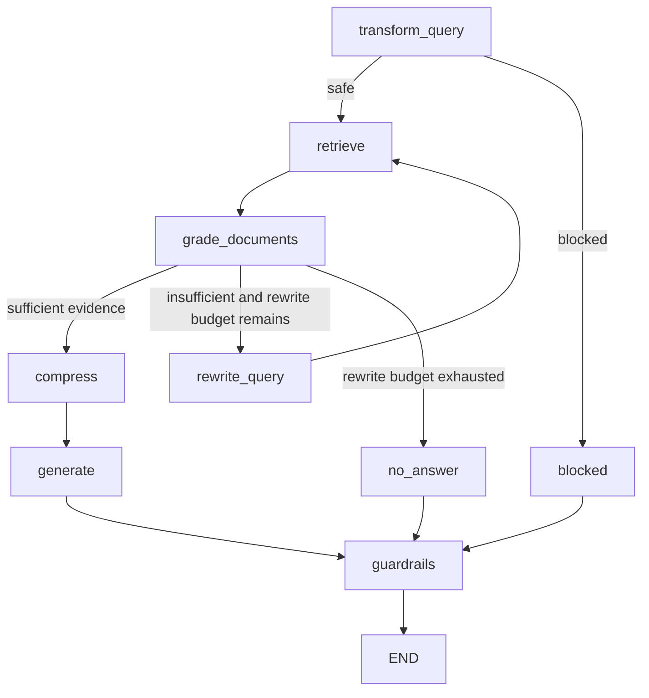

# Mortarium LangGraph RAG Architecture

Mortarium's retrieval-augmented generation workflow is implemented as a compiled
LangGraph `StateGraph`, not as a linear retrieval helper. LangGraph owns
workflow state transitions and checkpoint integration; the Agent Harness owns
the cross-cutting execution policy, identity boundary, memory/cache orchestration
and final response validation.

## Workflow

The current graph is:

The original user query is always retained as a retrieval candidate. Multi-query
rewrites supplement it; a rewrite must not silently replace medication names,
strengths, formulations or negations from the original. HyDE is an additional
candidate, not verified clinical evidence.

## Prompt trust boundary

All model-facing RAG stages use separate chat roles: policy and task constraints
are sent as `SystemMessage`; user questions and retrieved chunks are sent as
`HumanMessage`. Query and evidence payloads are explicitly treated as
untrusted data, and delimiter-like content is escaped before being placed in
structured prompt sections. This applies to document grading, query rewriting,
HyDE, multi-query generation, decomposition and final answer generation.

Retrieved text never becomes system policy. HyDE output is a retrieval aid, not
verified clinical evidence. The system prompt requires evidence-bounded answers
and exact source IDs; citation validation remains a separate post-generation
control.

## State and tenant boundary

`RAGState` carries the question, immutable `QueryContext`,
query candidates, retrieved and graded chunks, compressed evidence, bounded
rewrite count, warnings and response metadata.

`QueryContext` validates a non-empty user identifier and positive
pharmacy/patient identifiers. The API layer must construct this context only
after authenticating the user, verifying pharmacy membership and checking
patient membership in that pharmacy. Retrieval independently requires a
positive pharmacy_id filter and patient-level documents require an explicit
patient_id filter. These controls are defense in depth; caller-provided model
arguments must never establish identity.

## Bounded execution

- Query rewrite attempts are capped by `max_rewrites` (default: 2).
- Generated multi-query candidates are capped by `max_query_variations`
  in addition to the original query.
- Concurrent retrieval calls are limited by `max_retrieval_concurrency`
  (default: 6).
- Concurrent document grading calls are limited by
  `max_grading_concurrency` (default: 4).
- LangGraph receives an explicit recursion limit derived from the rewrite budget.
- The entire graph invocation has a 90-second default deadline; cancellation is
  propagated and marked in node spans rather than treated as an ordinary error.
- Retrieval and grading failures are represented as bounded warning codes; raw
  exception text is not copied into application logs.

These limits bound fan-out and graph loops. Per-node deadlines and graph-level
checkpoint-resume fault injection remain follow-up work and must be completed
before claiming full operational resilience. Cancellation propagation is
covered by regression tests.

## Persistence

Production graph construction requires an explicit checkpointer. The application
uses the PostgreSQL-backed async LangGraph checkpointer and namespaces RAG thread
IDs by pharmacy and user. Checkpoint payloads can contain user questions and
retrieved clinical context. Production retention, deletion, access-control and
backup policies must therefore be reviewed as part of the application's PHI
data lifecycle; database persistence alone is not a complete retention policy.

## Observability

Each graph node emits an OpenTelemetry span with bounded operational attributes:
rewrite count, retrieved/graded counts, warning count, execution outcome and
exception class. Node spans must not contain prompts, user/patient identifiers,
retrieved document text, prescription details or raw tool arguments.

See [OpenTelemetry privacy policy](../observability/opentelemetry.md) before
enabling any external trace exporter.
