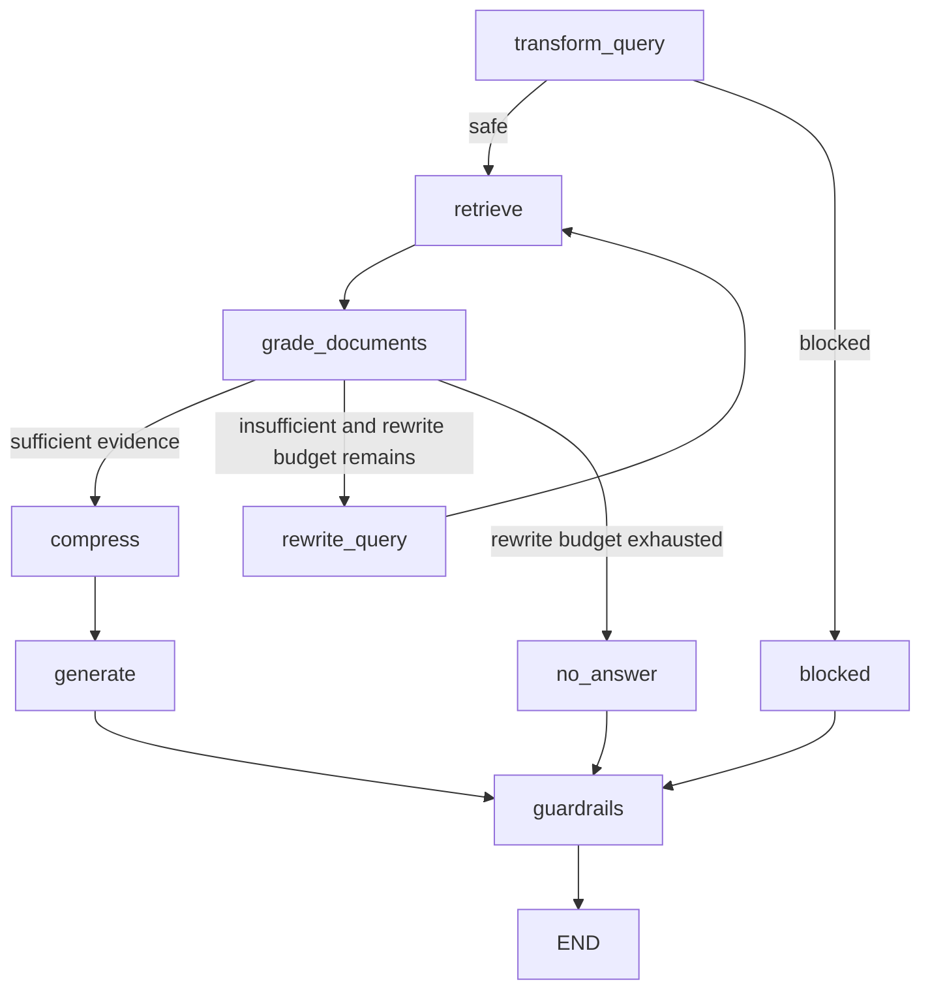

# Архитектура LangGraph RAG в Mortarium

Процесс retrieval-augmented generation (RAG) в Mortarium реализован как скомпилированный `StateGraph` LangGraph, а не как линейная функция поиска. LangGraph управляет переходами состояния процесса и интеграцией checkpoint; Agent Harness отвечает за сквозную политику выполнения, границу идентификации, оркестрацию памяти/кеша и финальную проверку ответа.

## Процесс

Текущий граф:

Исходный запрос пользователя всегда сохраняется как кандидат для поиска. Переформулировки multi-query дополняют его; переписывание не должно незаметно менять названия препаратов, дозировки, лекарственные формы или отрицания из исходного запроса. HyDE — дополнительный кандидат поиска, а не проверенное клиническое доказательство.

## Граница доверия prompt

Все этапы RAG, взаимодействующие с моделью, используют отдельные роли чата: политика и ограничения задачи передаются как `SystemMessage`; вопросы пользователя и извлечённые чанки — как `HumanMessage`. Запросы и содержимое доказательств явно рассматриваются как недоверенные данные; содержимое, похожее на разделители, экранируется перед включением в структурированные секции prompt. Это относится к оценке документов, переписыванию запросов, HyDE, генерации multi-query, декомпозиции запросов, контекстному сжатию предложений и финальной генерации ответа.

Извлечённый текст никогда не становится системной политикой. Результат HyDE служит вспомогательным материалом для поиска, а не проверенным клиническим доказательством. Системный prompt требует ответов в пределах доказательств и точных source ID; проверка цитат выполняется отдельно после генерации.

## State и граница tenant

`RAGState` хранит вопрос, неизменяемый `QueryContext`, кандидатов запросов, извлечённые и оценённые чанки, сжатые доказательства, ограниченный счётчик переписываний, предупреждения и метаданные ответа.

`QueryContext` проверяет непустой идентификатор пользователя и положительные идентификаторы аптеки/пациента. API-слой должен создавать этот контекст только после аутентификации пользователя, проверки членства в аптеке и принадлежности пациента этой аптеке. Retrieval независимо требует положительный фильтр `pharmacy_id`; для документов уровня пациента требуется явный фильтр `patient_id`. Это эшелонированная защита: аргументы модели, переданные вызывающей стороной, никогда не должны определять идентичность.

## Ограниченное выполнение

- Число попыток переписывания запроса ограничено `max_rewrites` (по умолчанию: 2).
- Число сгенерированных кандидатов multi-query ограничено `max_query_variations` в дополнение к исходному запросу.
- Параллельные вызовы retrieval ограничены `max_retrieval_concurrency` (по умолчанию: 6).
- Параллельные вызовы оценки документов ограничены `max_grading_concurrency` (по умолчанию: 4).
- Для LangGraph задаётся явный лимит рекурсии, рассчитанный на основе бюджета переписываний.
- Вызов всего графа имеет deadline 90 секунд по умолчанию; отмена передаётся дальше и отмечается в spans узлов, а не рассматривается как обычная ошибка.
- Ошибки retrieval и оценки представлены ограниченными кодами предупреждений; исходный текст исключения не копируется в application logs.

Эти ограничения сдерживают fan-out и циклы графа. Тайм-ауты на уровне отдельных узлов и fault-injection для восстановления графа из checkpoint остаются последующей работой; до её завершения нельзя заявлять о полной эксплуатационной устойчивости. Передача отмены покрыта регрессионными тестами.

## Персистентность

Для построения production-графа требуется явно заданный checkpointer. Приложение использует асинхронный checkpointer LangGraph на базе PostgreSQL и формирует namespace идентификаторов RAG thread по аптеке и пользователю. Payload checkpoint может содержать вопросы пользователя и извлечённый клинический контекст. Поэтому политики хранения, удаления, контроля доступа и резервного копирования production должны рассматриваться как часть жизненного цикла PHI-данных приложения; само по себе хранение в БД не является полноценной политикой retention.

## Наблюдаемость

Каждый узел графа создаёт OpenTelemetry span с ограниченным набором операционных атрибутов: количество переписываний, количество извлечённых/оценённых документов, количество предупреждений, результат выполнения и класс исключения. Spans узлов не должны содержать prompts, идентификаторы пользователя/пациента, текст извлечённых документов, сведения о рецептах или исходные аргументы инструментов.

Перед включением любого внешнего trace exporter ознакомьтесь с [политикой конфиденциальности OpenTelemetry](../observability/opentelemetry.md).
