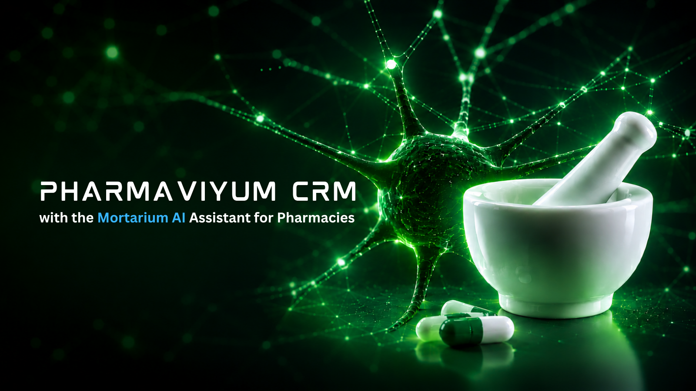

<p align="center">
  
</p>

# Senior Python Engineer | AI / LLM — Interview README

> **Interview-oriented engineering guide for Pharmaviyum CRM**
>
> This document presents the project from the perspective of a Senior Python Engineer working on production-oriented AI/LLM systems. It focuses on architecture, engineering decisions, reliability, security, testing, observability, and trade-offs rather than on business-sensitive implementation details.

## 1. What this project demonstrates

Pharmaviyum CRM is a modular pharmacy CRM platform built around:

- **Python 3.14.7 / FastAPI** for the backend API
- **PostgreSQL 16 + pgvector** for transactional and vector data
- **Redis** for cache/state and supporting infrastructure
- **Celery** for background ingestion and asynchronous workloads
- **React 19 + TypeScript + Vite 8** for the frontend
- **LangGraph / LangChain / Ollama** for AI orchestration and LLM integration
- **MCP JSON-RPC** for tool/resource integration
- **OpenTelemetry** for application observability
- **Docker / Docker Compose / Nginx** for local and deployment infrastructure

The project is intentionally structured as an engineering system rather than as a standalone LLM demo.

## 2. Architecture

```text
                         +----------------------+
                         |   React 19 Frontend  |
                         | TypeScript / Vite 8  |
                         +----------+-----------+
                                    |
                                    v
                         +----------------------+
                         |     FastAPI API      |
                         | Auth / Tenant / API  |
                         +----------+-----------+
                                    |
              +---------------------+----------------------+
              |                     |                      |
              v                     v                      v
       +-------------+       +-------------+        +-------------+
       | PostgreSQL  |       |    Redis    |        |  AI / RAG   |
       | + pgvector  |       | cache/state |        | LangGraph   |
       +-------------+       +-------------+        +------+------+ 
                                                            |
                                                     +------+------+
                                                     | LLM / Ollama|
                                                     +-------------+

                       Background workloads
                                |
                                v
                         Celery workers
```

### Architectural principles

1. **Clear boundaries** between API, domain logic, infrastructure, AI orchestration, and frontend.
2. **Database-first correctness** for transactional state; vector search complements rather than replaces relational storage.
3. **Tenant-aware AI execution** so retrieval and conversational state are scoped to authenticated context.
4. **Untrusted retrieval context**: documents retrieved for an LLM are treated as data, not as trusted instructions.
5. **Observable production workflows** with metrics, traces, structured logging, and controlled cardinality.
6. **Small, auditable changes** enforced through CI and incremental dependency upgrades.

## 3. Senior Python engineering practices

### Application structure

The backend follows a `src/` layout under `src/pharmaviyum` with separation of API, core infrastructure, domain concepts, models, and AI components.

The goal is to keep framework-specific concerns at the application boundary and avoid turning route handlers into large units of business logic.

### Async I/O

FastAPI endpoints use asynchronous I/O where appropriate. Database and network operations should remain non-blocking, while CPU-heavy or long-running work belongs in dedicated workers rather than inside request handlers.

### Type safety

The project uses modern Python typing and validates the codebase with **mypy**. CI uses:

```bash
mypy --explicit-package-bases src
```

The explicit package-base configuration is important for a `src/` layout because it prevents the same source file from being interpreted as multiple module paths.

### Formatting and linting

The quality gate includes:

```bash
ruff check .
black --check .
isort --check-only .
mypy --explicit-package-bases src
pytest
```

The principle is simple: formatting, imports, static analysis, and tests are automated gates rather than manual review tasks.

## 4. Data and persistence

### PostgreSQL

PostgreSQL is the system of record for transactional application data. SQLAlchemy provides the ORM/database abstraction and Alembic manages schema migrations.

Key engineering principles:

- migrations are versioned and repeatable;
- database constraints protect invariants where appropriate;
- transactions define consistency boundaries;
- indexes should be driven by measured query patterns;
- connection management must respect async application concurrency.

### pgvector

`pgvector` provides vector similarity search inside PostgreSQL. This reduces unnecessary infrastructure for the RAG path and allows application metadata and vector retrieval to participate in the same persistence architecture.

Vector search is treated as a retrieval mechanism, not as a source of truth.

## 5. AI / LLM architecture

The AI layer is located under `src/pharmaviyum/ai`.

The documented RAG flow is:

```text
Query
  -> transform_query
  -> retrieve
  -> grade_documents
  -> compress
  -> generate
  -> guardrails
```

### Why this pipeline exists

A production RAG system should not simply concatenate search results into a prompt. Each stage has a responsibility:

| Stage | Responsibility |
|---|---|
| `transform_query` | Normalize or enrich the user query for retrieval |
| `retrieve` | Fetch candidate documents within the allowed tenant/context scope |
| `grade_documents` | Evaluate retrieval relevance |
| `compress` | Reduce irrelevant context and token usage |
| `generate` | Produce an answer using the selected context |
| `guardrails` | Apply output and policy checks before returning the result |

### Retrieval security

Retrieved documents are considered **untrusted input**. This matters because a document can contain text that attempts to influence the model's behavior.

The application therefore keeps a conceptual distinction between:

- system/application instructions;
- authenticated user intent;
- retrieved external content;
- tool results;
- generated model output.

### Tenant isolation

The retrieval path carries authenticated pharmacy/tenant context. The same isolation principle applies to conversational state and checkpoint/thread scope.

A useful interview-level invariant is:

> A user must never be able to obtain another tenant's documents merely by manipulating a natural-language query.

This must be enforced by application/data-access controls, not by asking the LLM to behave correctly.

## 6. LLM reliability and production concerns

LLMs are probabilistic components. The surrounding application therefore owns deterministic responsibilities such as:

- authorization;
- tenant isolation;
- input validation;
- retrieval filtering;
- tool permissions;
- timeouts and retries;
- rate limiting;
- structured error handling;
- observability;
- output validation;
- auditability.

### Model-provider abstraction

The architecture keeps model integration behind application-level orchestration so that changing an LLM provider does not require rewriting the entire API or domain layer.

### Token and latency control

RAG quality is not only a retrieval problem. Production systems must also control:

- prompt size;
- retrieved document count;
- duplicate context;
- model latency;
- retry amplification;
- cost per request;
- streaming behavior.

## 7. MCP and tool use

The project includes an MCP JSON-RPC tool/resource layer.

Tool execution should follow the same security boundary as any other backend capability:

```text
User intent
    -> authorization
    -> tool selection
    -> validated arguments
    -> controlled execution
    -> structured result
    -> model / application response
```

The LLM should not receive unrestricted access to infrastructure. Tools should expose narrow capabilities with explicit input validation and authorization.

## 8. Background processing

Long-running document ingestion and other asynchronous workloads are separated from synchronous API requests and handled through Celery workers.

This prevents a slow ingestion task from unnecessarily occupying an API worker and allows the system to scale request handling and background workloads independently.

A production implementation should also consider:

- idempotency;
- retry policies;
- dead-letter handling where appropriate;
- task timeouts;
- backpressure;
- observability per task;
- safe duplicate execution.

## 9. Observability

The system includes application metrics and optional distributed tracing through OpenTelemetry.

The observability strategy should answer:

1. **What failed?** — structured errors and logs.
2. **Where did it fail?** — traces across API, database, retrieval, model, and tools.
3. **How often?** — metrics and error rates.
4. **How expensive/slow is it?** — latency, token/model timing, queue timing.
5. **Which tenant/request path is affected?** — controlled correlation identifiers.

High-cardinality identifiers should not be used indiscriminately as metric labels.

## 10. Security model

Security is treated as a cross-cutting engineering concern.

Important boundaries include:

- authentication and authorization at the API boundary;
- tenant/pharmacy isolation before retrieval;
- validation of external input;
- secrets supplied through environment/secret management rather than source control;
- retrieved documents treated as untrusted data;
- restricted tool permissions;
- controlled observability data;
- synthetic demo data in the public evaluation repository.

### AI-specific threat model

Important threats include:

- prompt injection through retrieved documents;
- indirect prompt injection through tool results;
- data leakage between tenants;
- excessive tool permissions;
- sensitive information appearing in logs/traces;
- denial of service through oversized prompts or repeated tool calls;
- model hallucination presented as authoritative application data.

The correct mitigation is defense in depth rather than a single prompt instruction.

## 11. Testing strategy

A production-oriented Python/AI system needs several layers of testing.

### Unit tests

Test deterministic business logic, validation, transformations, retrieval ranking helpers, and guardrail behavior without requiring external infrastructure.

### Integration tests

Validate interactions with PostgreSQL, Redis, the API layer, migrations, and other infrastructure boundaries.

### AI/RAG evaluation

LLM functionality should be evaluated with representative datasets and explicit metrics rather than relying only on manual examples.

Useful evaluation dimensions include:

- retrieval relevance;
- groundedness;
- citation/source correctness;
- refusal behavior;
- tenant isolation;
- latency;
- token usage;
- regression cases.

### End-to-end tests

The frontend uses Playwright for browser-level workflows, while Vitest covers frontend unit-level behavior.

## 12. CI/CD philosophy

CI is treated as an engineering gate.

The repository currently validates core Python quality through Ruff, Black, isort, mypy, security scanning, and tests. Dependency changes should be introduced incrementally and verified before unrelated changes are added.

A useful senior-engineering workflow is:

```text
Change
  -> focused commit
  -> static checks
  -> tests
  -> CI
  -> review
  -> merge
```

This makes failures attributable and keeps the history auditable.

## 13. Dependency management

Python dependency sources are separated by purpose:

- `pyproject.toml` — project metadata and dependency/tool configuration;
- `uv.lock` — generated, reproducible dependency resolution;
- `requirements.txt` — compatibility installation requirements.

Frontend dependencies are defined in `frontend/package.json` and managed with Bun's lockfile when present.

Lockfiles should be generated by their package manager. They should not be manually fabricated to make CI appear green.

## 14. Engineering trade-offs

### Why PostgreSQL + pgvector?

It keeps transactional data and vector retrieval close together and reduces infrastructure complexity for a CRM-sized application.

### Why LangGraph?

Explicit graph/state orchestration makes multi-step AI workflows easier to reason about than a single opaque model call.

### Why background workers?

Document ingestion and other long-running operations should not compete directly with latency-sensitive HTTP requests.

### Why guardrails outside the model?

Security and authorization cannot depend solely on probabilistic model behavior.

### Why strict CI?

Senior-level engineering is not only about writing working code. It is about keeping the codebase maintainable as multiple contributors, dependencies, environments, and production constraints evolve.

## 15. Interview discussion topics

This project can be used to discuss the following Senior Python / AI engineering topics:

### Python

- async/await and I/O concurrency;
- typing and mypy;
- dependency injection;
- exception boundaries;
- package architecture and `src/` layout;
- testing strategy;
- performance profiling;
- resource lifecycle management.

### FastAPI

- dependency injection;
- authentication and authorization;
- middleware;
- request validation;
- async database access;
- OpenAPI;
- background work versus worker queues.

### Databases

- PostgreSQL indexing;
- transactions and isolation;
- migrations;
- connection pools;
- vector indexes and similarity search;
- relational versus vector retrieval responsibilities.

### AI / LLM

- RAG architecture;
- embeddings and vector search;
- chunking and retrieval quality;
- reranking/grading;
- prompt injection;
- tool calling;
- MCP;
- hallucination mitigation;
- evaluation and observability;
- latency and token-cost management.

### Distributed systems

- queues;
- retries;
- idempotency;
- timeouts;
- backpressure;
- caching;
- observability;
- failure isolation.

### Engineering leadership

- incremental delivery;
- architecture decision records;
- code review;
- technical debt management;
- dependency upgrade strategy;
- CI quality gates;
- production incident reasoning.

## 16. What I would protect most carefully in production

For a pharmacy-oriented AI system, the highest-priority engineering concerns are:

1. **Data isolation and authorization**
2. **Correctness of transactional data**
3. **Auditability of important actions**
4. **AI output grounding and source traceability**
5. **Controlled tool permissions**
6. **Observability without leaking sensitive data**
7. **Predictable failure behavior**
8. **Safe dependency and schema evolution**

These concerns should remain true even if the underlying LLM, retrieval implementation, or frontend framework changes.

## 17. Repository references

- Main project README: [`../../README.md`](../../README.md)
- AI architecture: [`../ai_architecture.md`](../ai_architecture.md)
- Backend: [`../../src/pharmaviyum`](../../src/pharmaviyum)
- Frontend: [`../../frontend`](../../frontend)
- Tests: [`../../tests`](../../tests)
- Docker Compose: [`../../docker-compose.yml`](../../docker-compose.yml)

## 18. Interview framing

The central engineering message of this project is:

> **The LLM is a component of the system, not the system itself.**

A senior AI engineer is responsible for the deterministic architecture around the model: data boundaries, authorization, retrieval, tool permissions, validation, reliability, observability, testing, and operational behavior.

That principle keeps the application maintainable even as models and AI frameworks evolve.

---

**Pharmaviyum CRM — Senior Python Engineer | AI / LLM interview documentation**  
© 2026 Pharmaviyum. All rights reserved.
