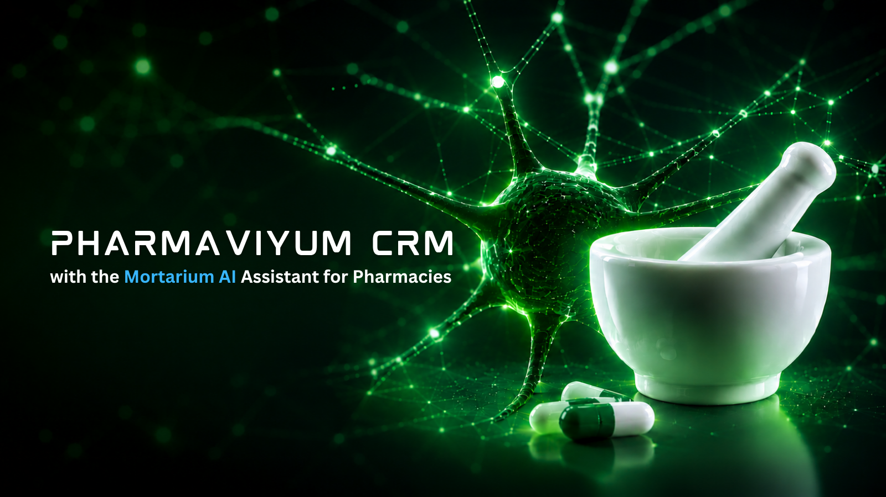

<p align="center">
  
</p>

# Senior System Design | Python + AI / LLM — Interview Guide

> **System-design interview documentation for Pharmaviyum CRM**
>
> This guide explains how to reason about the Pharmaviyum CRM architecture as a Senior Engineer: requirements, boundaries, data flow, scalability, reliability, security, observability, AI-specific failure modes, and engineering trade-offs.

## 1. How to approach a system-design interview

A strong system-design answer should not start with technologies. Start with the problem.

```text
Requirements
    ↓
Scale / SLOs / constraints
    ↓
High-level architecture
    ↓
Data model + APIs
    ↓
Critical request flows
    ↓
Failure modes
    ↓
Security
    ↓
Observability
    ↓
Scaling strategy
    ↓
Trade-offs
```

### Interview rule

> **Make assumptions explicit, quantify where possible, and explain why each architectural decision exists.**

Do not say “we use Redis because Redis is fast.” Explain what state is cached, what happens on a cache miss, how stale data is handled, and whether correctness depends on the cache.

---

## 2. Problem statement

Pharmaviyum CRM is a multi-tenant pharmacy-oriented platform with a web frontend, synchronous APIs, transactional data, asynchronous ingestion, and an AI/RAG layer.

The system needs to support:

- authenticated users and pharmacy/tenant boundaries;
- transactional CRM operations;
- document ingestion;
- semantic retrieval;
- conversational AI;
- tool execution through MCP;
- streaming AI responses;
- background processing;
- observability and operational diagnostics.

The important design constraint is that the LLM is **not** the system of record and must not become an authorization boundary.

---

## 3. Current high-level architecture

```text
                              ┌──────────────────────┐
                              │   React 19 Frontend  │
                              │ TypeScript / Vite 8  │
                              └──────────┬───────────┘
                                         │ HTTPS
                                         ▼
                              ┌──────────────────────┐
                              │      FastAPI API     │
                              │ auth / validation    │
                              │ tenant context       │
                              └──────────┬───────────┘
                                         │
                ┌────────────────────────┼────────────────────────┐
                │                        │                        │
                ▼                        ▼                        ▼
       ┌────────────────┐      ┌────────────────┐       ┌─────────────────┐
       │  PostgreSQL    │      │     Redis      │       │    AI Layer     │
       │  + pgvector    │      │ cache / state  │       │ Agent + RAG     │
       │ source of truth│      └────────────────┘       └────────┬────────┘
       └────────────────┘                                       │
                ▲                                                ▼
                │                                       ┌─────────────────┐
                │                                       │ LLM / Ollama /  │
                │                                       │ configured model│
                │                                       └─────────────────┘
                │
       ┌────────┴────────┐
       │ Celery workers  │
       │ ingestion/tasks │
       └─────────────────┘

                    MCP tools + OpenTelemetry
                         │              │
                         └──────┬───────┘
                                ▼
                         application boundary
```

The implemented AI architecture confirms that FastAPI establishes authentication and tenant context before the AI API, while the AI layer connects the Agent Harness, RAG graph, MCP tools, PostgreSQL/pgvector, Redis, and configured LLM provider. fileciteturn56file0L2-L2

---

# 4. Requirements

## Functional requirements

1. Users authenticate against the application.
2. A user operates within an authorized pharmacy/tenant context.
3. CRUD operations use transactional persistence.
4. Documents can be ingested asynchronously.
5. Documents become searchable through semantic retrieval.
6. Users can ask questions through an AI interface.
7. AI responses can stream to the client.
8. The AI system can use authorized tools.
9. Responses should provide source references when retrieval is used.
10. Operators can inspect health, metrics, logs, and traces.

## Non-functional requirements

The exact production numbers should be agreed with the product/SRE context. During an interview, state assumptions explicitly instead of inventing requirements.

Typical dimensions to discuss:

| Dimension | Questions |
|---|---|
| Availability | What percentage of requests must succeed? |
| Latency | What is the API p95 target? What about first-token latency? |
| Throughput | Requests/sec? Concurrent AI sessions? |
| Consistency | Which operations require strong consistency? |
| Durability | What data cannot be lost? |
| Security | What are the tenant-isolation requirements? |
| Cost | What is the acceptable AI cost/request? |
| Retention | How long are conversations and documents retained? |

---

# 5. Data ownership and source of truth

A senior design should clearly identify the authoritative owner of every important piece of state.

| Data | System of record | Cache / derived state |
|---|---|---|
| Users | PostgreSQL | Redis may cache selected lookups |
| Pharmacy membership | PostgreSQL | Request-scoped context |
| CRM entities | PostgreSQL | Optional read cache |
| Documents | PostgreSQL / object storage where applicable | Retrieval indexes |
| Embeddings | PostgreSQL + pgvector | Derived from source documents |
| Conversation state | Application persistence / configured memory | Redis for selected transient state |
| LLM output | Not authoritative | Response/cache only when safe |
| Metrics | Observability backend | Never business source of truth |

### Core rule

> If deleting the cache would corrupt the business state, the cache is being used incorrectly.

---

# 6. Multi-tenancy and authorization

Tenant isolation is one of the most important system-design topics for this application.

The security boundary should look like:

```text
Request
  ↓
Authentication
  ↓
User identity
  ↓
Pharmacy membership / authorization
  ↓
Tenant context
  ↓
Data-access filter
  ↓
Retrieval filter
  ↓
Tool authorization
  ↓
LLM orchestration
```

The AI architecture explicitly documents tenant-safe retrieval and authenticated pharmacy/user checkpoint scope. fileciteturn56file0L2-L2

### What must NOT happen

```text
User query
   ↓
LLM decides which tenant data it may access
```

Natural language is not an authorization mechanism.

### Interview question

**How would you prevent cross-tenant data leakage in RAG?**

Answer structure:

1. Authenticate the user.
2. Resolve authorized tenant membership.
3. Carry tenant context through the request.
4. Apply tenant predicates before retrieval.
5. Apply authorization again before tool execution.
6. Never expose arbitrary document IDs as a security boundary.
7. Test cross-tenant access explicitly.
8. Log security-relevant decisions without leaking sensitive content.

---

# 7. API design

A typical request path is:

```text
Frontend
  → HTTPS
  → FastAPI route
  → authentication dependency
  → tenant authorization
  → application/service layer
  → repository/data access
  → PostgreSQL / Redis / AI
  → response
```

### API principles

- validate inputs at the boundary;
- keep authorization close to the resource boundary;
- keep route handlers thin;
- use explicit schemas;
- return structured errors;
- define timeouts for downstream calls;
- avoid exposing infrastructure details to clients;
- make retry semantics explicit.

For AI streaming, distinguish **request acceptance**, **first token**, **stream completion**, and **stream failure** as separate operational events.

---

# 8. PostgreSQL design

PostgreSQL is the transactional source of truth.

Important design questions:

### Indexing

Indexes should follow real access patterns:

```text
Query pattern
    ↓
EXPLAIN / measurements
    ↓
Index decision
    ↓
Load-test validation
```

Do not create indexes simply because a column “might be searched.”

### Transactions

Use transactions around business invariants rather than around arbitrary HTTP boundaries.

Examples:

- creating a CRM entity plus required related records;
- changing membership plus authorization state;
- recording an important business action plus its audit record.

### Connection pools

Async APIs can create high concurrency. The database connection pool must be sized against PostgreSQL capacity, not simply against the number of HTTP workers.

---

# 9. pgvector system design

The vector store is a retrieval subsystem, not the authoritative data store.

```text
Source document
      ↓
chunking
      ↓
embedding
      ↓
PostgreSQL + pgvector
      ↓
semantic retrieval
      ↓
relevance grading
      ↓
context compression
      ↓
LLM generation
```

The current RAG pipeline follows:

```text
transform_query
    → retrieve
    → grade_documents
    → compress
    → generate
    → guardrails
```

This is explicitly documented in the repository's AI architecture. fileciteturn56file0L2-L2

### Retrieval quality questions

An interviewer may ask:

- How do you choose chunk size?
- How do you prevent duplicate chunks?
- How do you filter by tenant?
- How do you handle stale embeddings?
- What happens when retrieval returns nothing?
- How do you evaluate recall?
- When would you add a reranker?
- When would you move vector search to a dedicated system?

A senior answer should discuss **measurement**, not just configuration values.

---

# 10. RAG architecture

The system treats retrieved documents as untrusted input.

```text
User query
    ↓
Query transformation
    ↓
Tenant-safe retrieval
    ↓
Document grading
    ↓
Context compression
    ↓
Prompt construction
    ↓
LLM
    ↓
Guardrails
    ↓
Response + citations
```

The implemented AI documentation specifies stable source identifiers, citation materialization, tenant-safe retrieval, and low-cardinality retrieval metrics. fileciteturn56file0L2-L2

### Why grading?

Top-k similarity does not guarantee useful context. A grading step creates an opportunity to reject irrelevant candidates before generation.

### Why compression?

It reduces irrelevant tokens, model latency, and potentially model cost while preserving useful evidence.

### Why guardrails?

Generation is probabilistic. Authorization, source validation, output constraints, and safety checks must remain outside the model's “good intentions.”

---

# 11. Agent architecture

The Agent Harness is an application-level orchestration boundary around model calls.

Its documented responsibilities include:

- model routing;
- dialogue memory;
- guardrails;
- caching;
- tool access;
- observability. fileciteturn56file0L2-L2

The design principle is:

```text
Application policy
       ↓
Agent orchestration
       ↓
Model
       ↓
Validated result
```

not:

```text
Model
  ↓
Everything
```

---

# 12. MCP and tool execution

MCP is an internal application component exposing JSON-RPC tools/resources. The repository documents authorization integration with application roles and pharmacy membership. fileciteturn56file0L2-L2

A safe tool flow is:

```text
LLM proposes tool call
        ↓
Application validates tool name
        ↓
Authorization check
        ↓
Argument validation
        ↓
Rate / timeout policy
        ↓
Tool execution
        ↓
Structured result
        ↓
Model / application
```

### Critical interview point

**The LLM can propose an action; the application decides whether that action is allowed.**

---

# 13. Redis design

Redis should have an explicit role.

Potential uses:

- caching;
- short-lived conversational state;
- rate limiting;
- distributed coordination where justified;
- Celery broker/result infrastructure depending on deployment configuration.

For every Redis use, answer:

1. What is the key?
2. What is the TTL?
3. What happens on cache miss?
4. What happens if Redis is unavailable?
5. Can stale data be served?
6. Is the data security-sensitive?
7. Does correctness depend on Redis?

---

# 14. Asynchronous processing

Document ingestion should not block an interactive HTTP request.

```text
HTTP request
   ↓
Validate + authorize
   ↓
Create ingestion job
   ↓
Queue
   ↓
Celery worker
   ↓
Parse
   ↓
Chunk
   ↓
Embed
   ↓
Persist
   ↓
Update job status
```

The repository documents ingestion under the RAG ingestion package and its integration with the Celery worker in the development Docker Compose stack. fileciteturn56file0L2-L2

### Why a queue?

It provides isolation between latency-sensitive requests and workloads whose execution time is variable.

### Idempotency

An ingestion job should be safe to retry. A common strategy is to derive a stable document/version identity and make writes idempotent.

---

# 15. Reliability patterns

## Timeouts

Every external dependency should have an explicit timeout.

```text
No timeout
    → stuck worker
    → connection exhaustion
    → queue growth
    → cascading failure
```

## Retries

Retry only failures that are plausibly transient.

Use:

- bounded attempts;
- exponential backoff;
- jitter;
- idempotent operations;
- retry budgets.

Never blindly retry every exception.

## Circuit breaking

For an unstable downstream model/provider, circuit breaking can prevent the application from continuously spending resources on requests that are likely to fail.

## Backpressure

If ingestion is faster than embedding/model/database capacity, the queue should absorb bounded load rather than allowing unlimited concurrency.

---

# 16. AI-specific reliability

AI systems add failure modes that traditional CRUD systems do not have.

| Failure | System response |
|---|---|
| LLM timeout | Bounded timeout + controlled fallback/error |
| Empty retrieval | Explicit no-evidence path |
| Irrelevant retrieval | Grading/compression |
| Prompt injection | Treat retrieved content as untrusted |
| Tool abuse | Authorization outside model |
| Hallucination | Grounding + citations + validation |
| Provider outage | Provider routing/fallback where justified |
| Token explosion | Context limits + compression |
| Retry amplification | Retry budgets and backoff |
| Slow generation | Streaming + latency metrics |

---

# 17. Caching strategy

Caching should be classified before implementation.

### Safe candidates

- immutable/reference data;
- expensive deterministic computations;
- selected retrieval results with clear invalidation semantics;
- short-lived metadata.

### Dangerous candidates

- authorization decisions without strict invalidation;
- rapidly changing transactional state;
- sensitive data without isolation controls;
- model outputs where freshness or personalization matters.

### Cache-aside pattern

```text
Read
 ↓
Cache lookup
 ├─ hit  → return
 └─ miss → DB
             ↓
          populate cache
             ↓
           return
```

Always define invalidation before defining the cache.

---

# 18. Observability

The system should expose three primary observability dimensions:

```text
Metrics + Logs + Traces
```

For AI systems add:

- time to first token;
- generation latency;
- retrieval latency;
- retrieval result count;
- model/provider errors;
- token usage where available;
- tool invocation counts;
- queue latency;
- ingestion duration.

The repository intentionally keeps retrieval metrics low-cardinality and does not put tenant, user, or session identifiers into Prometheus labels. fileciteturn56file0L2-L2

### Why low cardinality matters

A metric label with an unbounded user/session ID can create an uncontrolled number of time series and become an operational problem itself.

---

# 19. Security architecture

Security should be layered:

```text
TLS
 ↓
Authentication
 ↓
Authorization
 ↓
Tenant isolation
 ↓
Input validation
 ↓
Data access controls
 ↓
Tool authorization
 ↓
LLM guardrails
 ↓
Output validation
 ↓
Audit / observability
```

### AI threat model

Discuss these explicitly in a Senior interview:

- direct prompt injection;
- indirect prompt injection through documents;
- malicious tool arguments;
- cross-tenant retrieval;
- sensitive data in prompts/logs;
- excessive tool permissions;
- denial of service through oversized input;
- model-generated false claims;
- compromised model/provider dependencies.

Defense in depth is more reliable than prompt-only security.

---

# 20. Scaling strategy

Do not scale everything horizontally by default.

Scale according to the bottleneck.

```text
                Load
                  ↓
             API workers
                  ↓
        ┌─────────┴─────────┐
        ↓                   ↓
   PostgreSQL            Redis
        ↓                   ↓
   pgvector          queue/cache
        ↓
   Celery workers
        ↓
   Embedding / LLM providers
```

### Likely bottlenecks

- PostgreSQL connections;
- vector search latency;
- embedding throughput;
- LLM latency;
- provider rate limits;
- queue backlog;
- network bandwidth;
- token budget.

The first step is measurement, not adding more services.

---

# 21. Availability and graceful degradation

Not every subsystem needs identical availability.

Example:

```text
CRM CRUD
  ↓
Must remain available even if AI provider is down

AI assistant
  ↓
May degrade to explicit unavailable response

Analytics
  ↓
May be delayed

Document ingestion
  ↓
May queue and catch up later
```

This is an important senior-level distinction: **degrade selectively instead of allowing one dependency to take down the whole platform.**

---

# 22. Deployment architecture

The development architecture uses Docker Compose for PostgreSQL/pgvector, Redis, Ollama, FastAPI, and Celery ingestion. The documented release path uses GitHub Actions, GHCR, Ansible, and `deploy/docker-compose.release.yml`. fileciteturn56file0L2-L2

A production evolution can introduce additional infrastructure only when justified by measurable requirements.

### Avoid premature microservices

A modular monolith can be the correct architecture while the system is still evolving.

Extract a service when there is a concrete reason:

- independent scaling;
- independent deployment cadence;
- clear ownership boundary;
- different reliability requirements;
- isolation of heavy workloads;
- technology boundary.

---

# 23. System-design trade-offs

## PostgreSQL + pgvector vs dedicated vector database

**PostgreSQL + pgvector**

- fewer infrastructure components;
- relational metadata close to vectors;
- simpler transactional integration.

**Dedicated vector platform**

- potentially specialized scaling characteristics;
- operational separation;
- potentially useful for very large retrieval workloads.

The correct choice depends on scale, latency, operational constraints, and query requirements.

## Celery vs synchronous processing

Synchronous processing is simpler for short deterministic work. Celery is appropriate when workload duration is variable, retryable, or operationally independent from the HTTP request.

## Monolith vs microservices

Start with clear module boundaries. Split only when operational or organizational requirements justify the additional distributed-system complexity.

## LLM fallback vs fail-fast

Fallbacks can improve availability but may increase complexity, cost, and behavioral inconsistency. Define which failures are worth falling back from and measure the result.

---

# 24. Common system-design interview questions

## Q1. Design a multi-tenant AI CRM.

Cover:

- tenant model;
- authentication;
- authorization;
- database isolation;
- retrieval filtering;
- tool authorization;
- observability;
- auditability.

## Q2. How do you prevent RAG data leakage?

Cover:

- tenant context before retrieval;
- database filters;
- authorization before tools;
- source validation;
- adversarial tests;
- no LLM-based authorization.

## Q3. How would you scale the AI API?

Cover:

- stateless API workers;
- streaming;
- queue isolation;
- connection pools;
- provider limits;
- caching where safe;
- backpressure;
- metrics.

## Q4. What happens if the LLM provider goes down?

Cover:

- timeout;
- bounded retries;
- circuit breaker;
- fallback if justified;
- graceful error;
- monitoring;
- preserving core CRM availability.

## Q5. How would you process one million documents?

Cover:

- asynchronous ingestion;
- partitioning/batching;
- idempotency;
- queue throughput;
- embedding concurrency;
- rate limits;
- database write batching;
- progress tracking;
- retry/dead-letter strategy;
- backpressure.

## Q6. When would you introduce Kafka?

Do not answer “when traffic is high.” Discuss:

- event volume;
- multiple consumers;
- replay requirements;
- ordering requirements;
- retention;
- decoupling;
- operational cost.

## Q7. How would you make ingestion idempotent?

Define a stable document/version identity and ensure retries do not create duplicate business state or duplicate vector records.

## Q8. How do you handle slow AI responses?

Discuss:

- streaming;
- time-to-first-token;
- retrieval optimization;
- context compression;
- model selection;
- timeouts;
- concurrency limits;
- caching where safe.

## Q9. How do you choose between Redis and PostgreSQL?

Use PostgreSQL for durable authoritative state. Use Redis for transient/derived state where its performance and data structures justify the operational dependency.

## Q10. What is your first step when production latency increases?

Measure the critical path before changing architecture:

```text
Request
 → auth
 → DB
 → retrieval
 → model
 → tools
 → response
```

Find the dominant component, then optimize that component.

---

# 25. Senior-level failure scenarios

### Scenario A — PostgreSQL is slow

Questions:

- Is the issue CPU, I/O, locks, connections, or a query plan?
- Is the connection pool saturated?
- Did a deployment change query patterns?
- Can read traffic be cached safely?

### Scenario B — Redis is unavailable

Questions:

- Is Redis required for correctness?
- Can requests fall back to PostgreSQL?
- Are queues blocked?
- What state is transient?

### Scenario C — Vector retrieval returns poor results

Investigate:

- chunking;
- embeddings;
- query transformation;
- filters;
- index configuration;
- grading/reranking;
- evaluation dataset.

Do not immediately blame the LLM.

### Scenario D — LLM generates an incorrect answer

Trace:

```text
User query
 → retrieval
 → retrieved evidence
 → prompt
 → model
 → guardrails
 → final response
```

Determine whether the failure came from retrieval, grounding, model behavior, tool output, or validation.

### Scenario E — Queue backlog grows continuously

Possible causes:

- insufficient workers;
- provider rate limit;
- database bottleneck;
- oversized tasks;
- retry storm;
- downstream outage.

Measure each stage before increasing concurrency.

---

# 26. Capacity-planning template

In an interview, use variables instead of pretending to know production traffic.

```text
R = requests/sec
C = concurrent requests
L = average latency

Approximate concurrency:
C ≈ R × L
```

For asynchronous ingestion:

```text
λin  = documents/sec arriving
λout = documents/sec processed

If λin > λout for a sustained period:
queue backlog grows.
```

For AI workloads also estimate:

- tokens/request;
- embedding calls/document;
- model calls/request;
- tool calls/request;
- provider rate limits;
- cost/request.

---

# 27. Architecture decision template

When proposing a design change, use:

```text
Problem
↓
Constraints
↓
Options
↓
Decision
↓
Why this option
↓
Trade-offs
↓
Failure modes
↓
Migration plan
↓
How we measure success
```

This is much stronger than saying “I would use X because it is industry standard.”

---

# 28. Interview checklist

Before finishing a system-design answer, check that you discussed:

- [ ] requirements
- [ ] scale assumptions
- [ ] APIs
- [ ] data model
- [ ] source of truth
- [ ] authentication
- [ ] authorization
- [ ] tenant isolation
- [ ] caching
- [ ] asynchronous work
- [ ] queues
- [ ] retries
- [ ] idempotency
- [ ] timeouts
- [ ] backpressure
- [ ] database scaling
- [ ] vector retrieval
- [ ] LLM architecture
- [ ] tool security
- [ ] observability
- [ ] security threats
- [ ] graceful degradation
- [ ] deployment
- [ ] trade-offs
- [ ] migration strategy

---

# 29. The five-minute system-design answer

When time is limited, use this structure:

### 1. Requirements — 30 sec

Clarify users, core workflows, scale, latency, availability, and consistency.

### 2. Architecture — 60 sec

Draw:

```text
Client → API → DB
          ↓
        Redis
          ↓
       Queue → Workers
          ↓
       AI/RAG → LLM
```

### 3. Data/security — 60 sec

Explain source of truth, tenant isolation, authorization, and sensitive-data boundaries.

### 4. Reliability/scaling — 90 sec

Explain timeouts, retries, idempotency, queues, backpressure, database limits, and provider limits.

### 5. AI-specific concerns — 60 sec

Explain retrieval, grounding, prompt injection, tool authorization, latency, token control, and evaluation.

### 6. Trade-offs — 30 sec

Explain what you intentionally did **not** build yet and why.

---

# 30. Senior interview mindset

The interviewer is not only evaluating whether you know technologies.

They are looking for whether you can:

- turn ambiguous requirements into explicit assumptions;
- identify the real bottleneck;
- separate correctness from performance optimization;
- design security boundaries;
- reason about failure rather than only the happy path;
- understand operational consequences;
- make reversible decisions where possible;
- avoid unnecessary distributed-system complexity;
- explain trade-offs clearly;
- define how success will be measured.

The strongest answer is rarely the one with the most services.

> **A senior system design is a set of explicit boundaries, invariants, failure strategies, and measured trade-offs.**

---

## Repository references

- Main project README: [`../../README.md`](../../README.md)
- AI architecture: [`../ai_architecture.md`](../ai_architecture.md)
- Interview engineering guide: [`./README.md`](./README.md)
- Interview Q&A: [`./INTERVIEW_QA.md`](./INTERVIEW_QA.md)
- Backend: [`../../src/pharmaviyum`](../../src/pharmaviyum)
- Frontend: [`../../frontend`](../../frontend)
- Tests: [`../../tests`](../../tests)
- Deployment: [`../../deploy`](../../deploy)

---

**Pharmaviyum CRM — Senior System Design | Python + AI / LLM interview documentation**  
© 2026 Pharmaviyum. All rights reserved.
