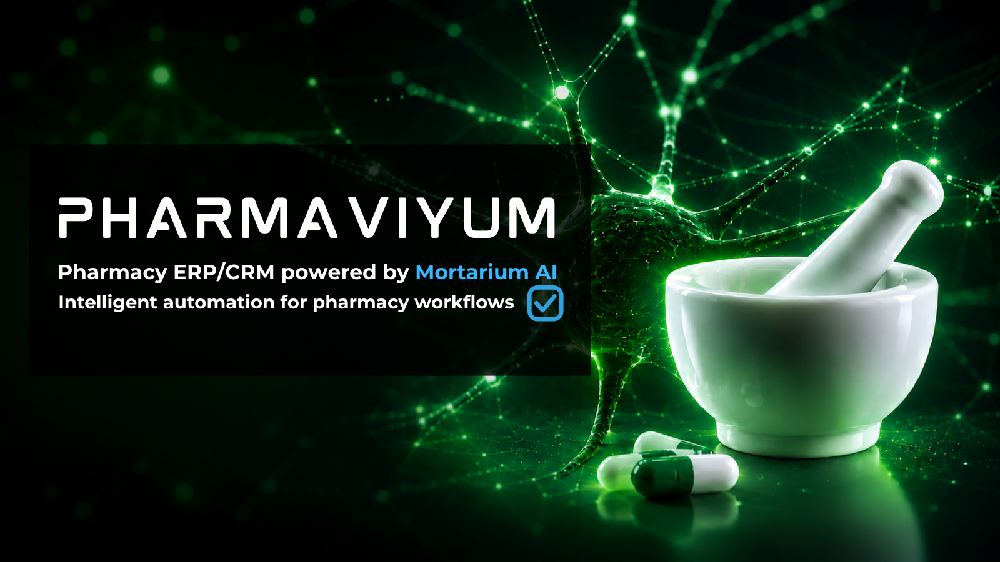

# Pharmaviyum — Pharmacy ERP/CRM

<p align="center">
  
</p>

> Pharmacy ERP/CRM platform with Mortarium AI for pharmacy operations, workflow, inventory, procurement, POS, and intelligent decision support.

## Overview

**Pharmaviyum** is a pharmacy-focused ERP/CRM platform with an integrated AI layer, **Mortarium**.

The project evolved from a pharmacy CRM with an AI layer into a broader pharmacy ERP/CRM foundation covering operational workflows such as patients, prescriptions, products, POS, procurement, suppliers, receiving, inventory, batches, expiry control, FEFO dispensing, stock transfers, and auditability.

The system is designed around real pharmacy workflows and can complement existing pharmacy ERP environments during gradual adoption rather than requiring an immediate replacement of existing systems.

## Frontend

The frontend is the operational administration interface for Pharmaviyum.

It provides the UI foundation for:

- Dashboard and pharmacy KPIs
- Patients and patient purchase history
- Prescriptions and dispensing workflows
- Products and drug reference
- POS and orders
- Inventory, batches, FEFO, and expiry control
- Procurement and suppliers
- Pharmacy locations and staff
- Auditability and operational visibility
- Mortarium AI decision-support workflows

## Technology Stack

- React
- TypeScript
- Vite
- TanStack Router
- TanStack Query
- Axios
- Tailwind CSS
- shadcn/ui
- Lucide Icons
- Vitest
- Playwright

The interface is designed with responsive layouts and accessibility in mind for both desktop and mobile pharmacy workflows.

## Run Locally

From the frontend directory:

```bash
cd frontend/shadcn-admin
bun install
bun run dev
```

Production build:

```bash
bun run build
```

Tests:

```bash
bun run test
bun run test:e2e
```

## Project Context

Pharmaviyum is developed as a pharmacy ERP/CRM foundation with a production-oriented FastAPI backend and the Mortarium AI layer.

The frontend is one part of the broader platform and is intentionally kept aligned with real pharmacy workflows rather than being a generic admin template.

## Demo / NDA Notice

- Demo data is synthetic.
- No real client data is included.
- Proprietary production integrations and business logic are not exposed here.
- Usage and redistribution are subject to the applicable NDA and author permission.

© 2026 Pharmaviyum. All rights reserved.
